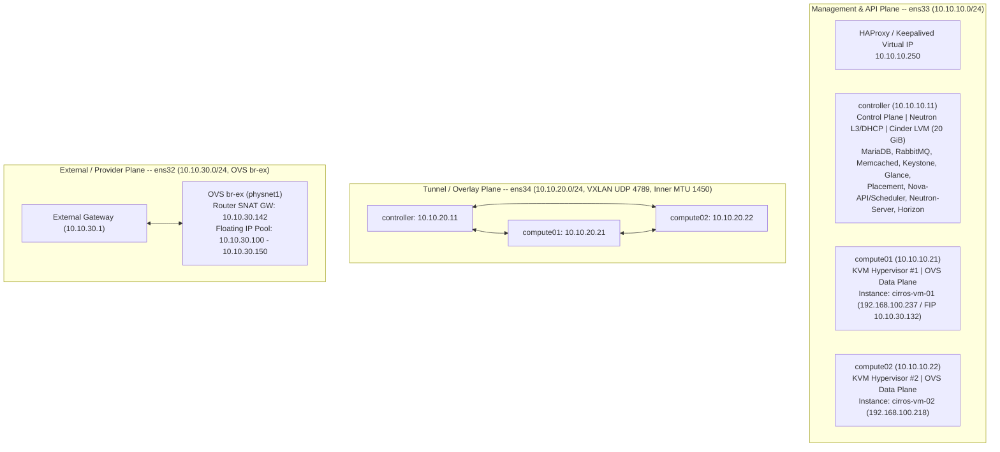

# Multi-Node OpenStack Private Cloud Architecture


-E95420?style=for-the-badge&logo=ubuntu&logoColor=white)


A production-modeled, 3-node **OpenStack 2025.2 (Flamingo)** private cloud deployed via **Kolla-Ansible** on **Ubuntu 24.04.5 LTS (`Linux 6.8.0-147-generic`)**. The cluster implements High-Availability API load balancing (**Keepalived + HAProxy + ProxySQL**), hardware-accelerated **KVM/QEMU** compute nodes, **Neutron ML2/Open vSwitch** Software-Defined Networking with cross-node **VXLAN (`UDP 4789`, `MTU 1450`)** tenant overlays and flat provider networks (`br-ex`), and **Cinder LVM/iSCSI** persistent block storage.

---

## Visual Dashboard Showcase (Horizon GUI)

| Neutron SDN Topology (`public-net` -> `demo-router` -> `private-net`) | Multi-Node Instances (`compute01` & `compute02`) |
| :---: | :---: |
|  |  |
| **KVM Hypervisors (`compute01` & `compute02`)** | **Cinder LVM Block Volumes (`/dev/vdb` Attached)** |
|  |  |


---

## 1. Infrastructure Topology & Network Segmentation

The cluster is segmented into three isolated network planes across every node to separate control-plane API traffic, East-West VXLAN tenant tunnels, and North-South external provider routing:



### Cluster Node Specifications

| Node | Role(s) | CPU / Virtualization | RAM / Swap | Mgmt (`ens33`) | Tunnel (`ens34`) | Provider (`ens32`) | Storage Layout |
| :--- | :--- | :--- | :--- | :--- | :--- | :--- | :--- |
| **`controller`** | Control Plane, Network Node, Block Storage (`controller@lvm-1`) | 2 vCPU (`VT-x`) | 5.0 GiB + `zram` | `10.10.10.11/24` (VIP `.250`) | `10.10.20.11/24` | OVS `br-ex` | `sda` (`23 GiB` OS) + `sdb` (`20 GiB` `cinder-volumes` VG) |
| **`compute01`** | KVM/QEMU Hypervisor #1, OVS Agent | 2 vCPU (`VT-x` `/dev/kvm`) | 2.5 GiB + `zram` | `10.10.10.21/24` | `10.10.20.21/24` | OVS `br-ex` | `sda` (`23 GiB` OS + Nova ephemeral) |
| **`compute02`** | KVM/QEMU Hypervisor #2, OVS Agent | 2 vCPU (`VT-x` `/dev/kvm`) | 2.5 GiB + `zram` | `10.10.10.22/24` | `10.10.20.22/24` | OVS `br-ex` | `sda` (`23 GiB` OS + Nova ephemeral) |

---

## 2. SDN Data-Plane & Storage Packet Path

```mermaid
flowchart LR
    EXT["External Network<br/>10.10.30.0/24"] -->|Floating IP<br/>10.10.30.132| BREX["controller: br-ex<br/>(ens32)"]
    BREX --> QROUTER["ip netns: qrouter-fd19fb5e...<br/>DNAT 10.10.30.132 -> 192.168.100.237"]
    QROUTER --> CTRL_TUN["controller: br-tun<br/>vxlan-0a0a1415"]
    CTRL_TUN -->|VXLAN UDP 4789<br/>10.10.20.11 -> 10.10.20.21| C1_TUN["compute01: br-tun<br/>(ens34)"]
    C1_TUN --> C1_INT["compute01: br-int<br/>qvo2eb7fb00-41 (tag: 1)"]
    C1_INT --> VM1["cirros-vm-01 (compute01)<br/>eth0: 192.168.100.237 (MTU 1450)<br/>vdb: 1 GiB Cinder iSCSI Volume"]
    VM1 <-->|East-West VXLAN UDP 4789<br/>10.10.20.21 <-> 10.10.20.22| VM2["cirros-vm-02 (compute02)<br/>eth0: 192.168.100.218 (MTU 1450)"]
```



1. **North-South Floating IP Routing (`10.10.30.132 -> 192.168.100.237`):**
   - Ingress traffic arrives on `ens32` (`br-ex`) on `controller` and enters the `qrouter-fd19fb5e-4fb4-46c0-964c-417e737a2f19` network namespace via `qg-ffd42f43-ab` (`10.10.30.142`).
   - Kernel `iptables` `PREROUTING`/`OUTPUT` DNAT translates `10.10.30.132` to `192.168.100.237` and forwards the packet out `qr-e86a4b9f-d5` (`192.168.100.1`) into `br-int` -> `br-tun` (`vxlan-0a0a1415`) over `ens34` (`10.10.20.11 -> 10.10.20.21`) to `compute01`.
2. **East-West Cross-Hypervisor Overlay (`compute01 <-> compute02`):**
   - Packets between `cirros-vm-01` (`192.168.100.237` on `compute01`) and `cirros-vm-02` (`192.168.100.218` on `compute02`) are encapsulated with a 50-byte VXLAN header (`8B VXLAN + 8B UDP 4789 + 20B IP + 14B Ethernet`) by `br-tun` and transmitted directly between `10.10.20.21` and `10.10.20.22`.
3. **Cinder LVM/iSCSI Block Storage (`controller:/dev/sdb -> compute01:/dev/vdb`):**
   - `cinder-volume` (`controller@lvm-1`) allocates thin Logical Volume `volume-acf33885-2cb2-4538-a420-2e542cc7f748` (`1.00 GiB`) inside `cinder-volumes-pool` on `/dev/sdb` and exports it via `tgtd` (iSCSI Target) to `compute01`'s `iscsid` initiator, where `nova_libvirt` attaches it to `cirros-vm-01` as `/dev/vdb`.

---

## 3. Live Cluster Verification

### 3.1 Multi-Node Compute Services & Neutron SDN Agents
```text
$ openstack compute service list
+--------------------------------------+----------------+------------+----------+---------+-------+----------------------------+
| ID                                   | Binary         | Host       | Zone     | Status  | State | Updated At                 |
+--------------------------------------+----------------+------------+----------+---------+-------+----------------------------+
| 8015d4d8-f2fe-46ac-8791-b18b815539e2 | nova-scheduler | controller | internal | enabled | up    | 2026-11-05T04:08:06.000000 |
| 6849074c-0618-4e76-a0be-f166c0b2e124 | nova-conductor | controller | internal | enabled | up    | 2026-11-05T04:08:07.000000 |
| 676b96b7-6aa0-4fe4-9921-800eba2c4c73 | nova-compute   | compute01  | nova     | enabled | up    | 2026-11-05T04:08:08.000000 |
| dda5bbf5-9e78-44a2-af52-0bc5a02468f5 | nova-compute   | compute02  | nova     | enabled | up    | 2026-11-05T04:08:04.000000 |
+--------------------------------------+----------------+------------+----------+---------+-------+----------------------------+

$ openstack network agent list
+--------------------------------------+--------------------+------------+-------------------+-------+-------+---------------------------+
| ID                                   | Agent Type         | Host       | Availability Zone | Alive | State | Binary                    |
+--------------------------------------+--------------------+------------+-------------------+-------+-------+---------------------------+
| 693b750b-7521-4f5b-be05-acdc94e37436 | Open vSwitch agent | controller | None              | :-)   | UP    | neutron-openvswitch-agent |
| 728c624d-8d9a-4bd1-9fc0-452230b04b29 | Open vSwitch agent | compute02  | None              | :-)   | UP    | neutron-openvswitch-agent |
| 7aa42616-7eef-4ffe-9d6f-a9f1bddc0ced | L3 agent           | controller | nova              | :-)   | UP    | neutron-l3-agent          |
| 7bc2e4db-2bd5-4311-a767-e1c6019f06d0 | Open vSwitch agent | compute01  | None              | :-)   | UP    | neutron-openvswitch-agent |
| ebc7f808-7c21-440a-ac02-a399ca5f6abe | Metadata agent     | controller | None              | :-)   | UP    | neutron-metadata-agent    |
| fbb441b0-77ea-4a8a-8ed1-1407ced9fcaf | DHCP agent         | controller | nova              | :-)   | UP    | neutron-dhcp-agent        |
+--------------------------------------+--------------------+------------+-------------------+-------+-------+---------------------------+
```

### 3.2 Workload Placement, Cinder Volume Attach & Cross-Node VXLAN Connectivity
```text
$ openstack server list --long
+--------------------------------------+--------------+--------+------------+-------------+-------------------------------------------+--------------+---------+-----------+-------------+
| ID                                   | Name         | Status | Task State | Power State | Networks                                  | Image Name   | Flavor  | Host      | Host Status |
+--------------------------------------+--------------+--------+------------+-------------+-------------------------------------------+--------------+---------+-----------+-------------+
| dd5278d2-d9a7-4993-b231-5ded1a26b829 | cirros-vm-02 | ACTIVE | None       | Running     | private-net=192.168.100.218               | cirros-0.6.2 | m1.tiny | compute02 | UP          |
| 5f64ee18-3910-4d07-bece-3ee941b6889f | cirros-vm-01 | ACTIVE | None       | Running     | private-net=10.10.30.132, 192.168.100.237 | cirros-0.6.2 | m1.tiny | compute01 | UP          |
+--------------------------------------+--------------+--------+------------+-------------+-------------------------------------------+--------------+---------+-----------+-------------+

$ openstack volume list
+--------------------------------------+-------------+--------+------+---------------------------------------+
| ID                                   | Name        | Status | Size | Attached to                           |
+--------------------------------------+-------------+--------+------+---------------------------------------+
| acf33885-2cb2-4538-a420-2e542cc7f748 | demo-vol-01 | in-use |    1 | Attached to cirros-vm-01 on /dev/vdb  |
+--------------------------------------+-------------+--------+------+---------------------------------------+
```

```text
# SSH into cirros-vm-01 (compute01) via Floating IP 10.10.30.132, verify /dev/vdb, and ping cirros-vm-02 (compute02):
$ ssh cirros@10.10.30.132 "hostname && ip -br a show eth0 && lsblk && ping -c 3 192.168.100.218"
cirros-vm-01
eth0             UP             192.168.100.237/24 fe80::f816:3eff:fe29:606/64
NAME    MAJ:MIN RM  SIZE RO TYPE MOUNTPOINTS
vda     252:0    0    1G  0 disk
|-vda1  252:1    0 1015M  0 part /
`-vda15 252:15   0    8M  0 part
vdb     252:16   0    1G  0 disk
PING 192.168.100.218 (192.168.100.218) 56(84) bytes of data.
64 bytes from 192.168.100.218: icmp_seq=1 ttl=64 time=4.71 ms
64 bytes from 192.168.100.218: icmp_seq=2 ttl=64 time=1.06 ms
64 bytes from 192.168.100.218: icmp_seq=3 ttl=64 time=2.59 ms
--- 192.168.100.218 ping statistics ---
3 packets transmitted, 3 received, 0% packet loss, time 2004ms
```

---

## 4. Key Engineering Highlights

- **Control-Plane Memory Optimization (`10.0 GiB` Cluster Footprint):** Tuned `openstack_service_workers: "1"` and `openstack_service_rpc_workers: "1"` across all Gunicorn/uWSGI and Oslo RPC services, disabled Fluentd overhead, and configured `zram` (`lz4`) compressed swap to run 37 control-plane containers on `controller` and 2 KVM hypervisors with >2 GiB free RAM headroom.
- **VXLAN 50-Byte Overhead & MTU 1450 Verification:** Empirically verified the `1450-byte` inner MTU boundary (`ping -M do -s 1422` PASS vs. `-s 1472` FAIL) across `ens34` (`MTU 1500`) to prevent silent TCP/TLS blackholes.
- **Linux Kernel Cgroups v2 Isolation:** Validated per-scope memory ceilings (`MemoryMax`) and kernel `CONSTRAINT_MEMCG` OOM-killer behavior on `compute01`.
- **Data-Plane Fault Isolation:** Demonstrated zero-packet-loss forwarding continuity through `openvswitch_vswitchd` kernel datapath flows while `neutron_openvswitch_agent` was stopped and restarted on `compute01`.

---

## 5. Repository Structure

```text
.
├── configs/
│   ├── kolla/
│   │   ├── globals.yml                           # Production Kolla-Ansible configuration
│   │   └── multinode                             # 3-node Ansible inventory
│   └── netplan/                                  # 3-plane static Netplan configurations
├── docs/
│   ├── 01-host-and-network-setup.md              # Host virtualization, LVM expansion & 3-NIC setup
│   ├── 02-linux-cgroups-and-lvm.md               # Cgroups v2 OOM-killer & Cinder LVM provisioning
│   ├── 03-sdn-namespaces-vxlan.md                # Linux namespaces, veth, VXLAN & MTU 1450 math
│   ├── 04-kolla-ansible-deployment.md            # Containerized OpenStack 2025.2 deployment
│   ├── 05-workloads-and-failure-drills.md        # Multi-node VMs, Floating IP, Cinder & outage drill
│   └── 06-troubleshooting-and-interview-star.md  # Production troubleshooting STAR case studies
└── evidence/                                     # Raw terminal verification logs from all 3 nodes
```
