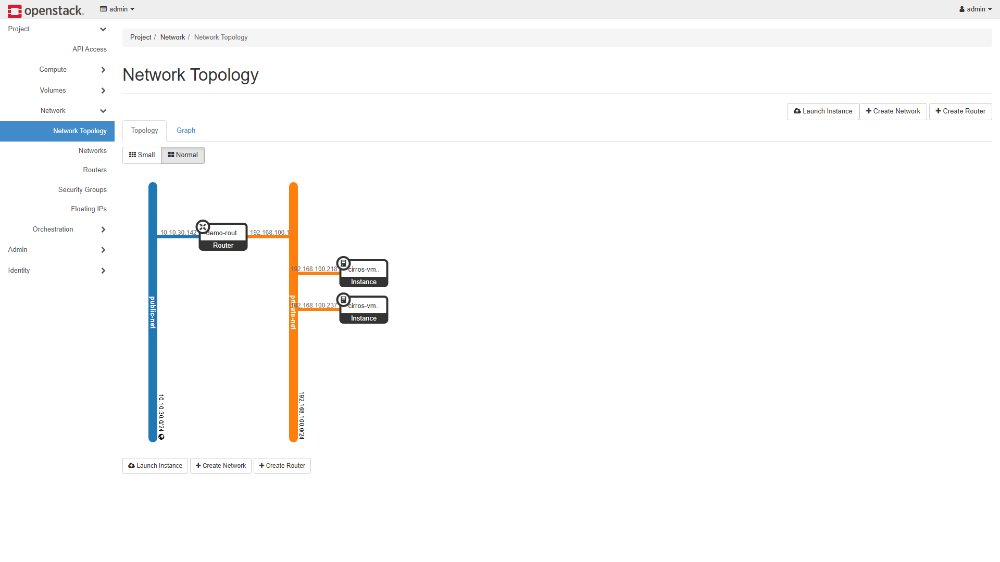
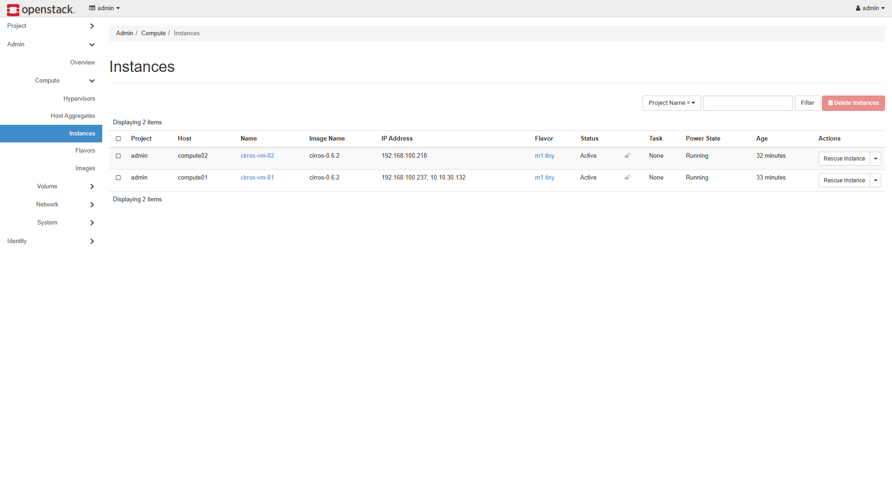
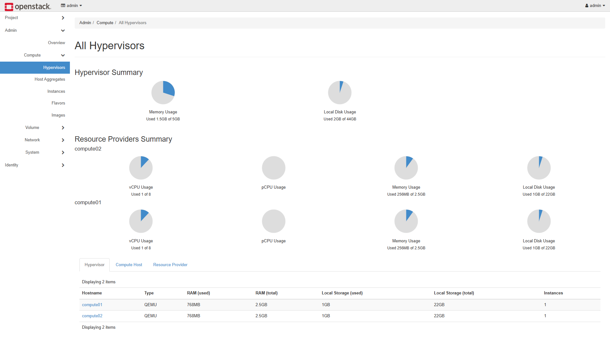
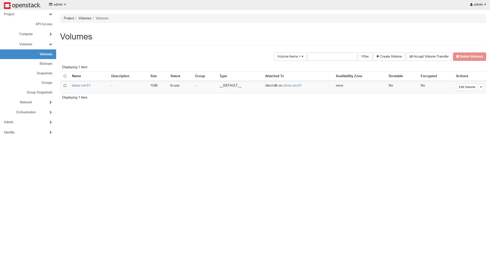
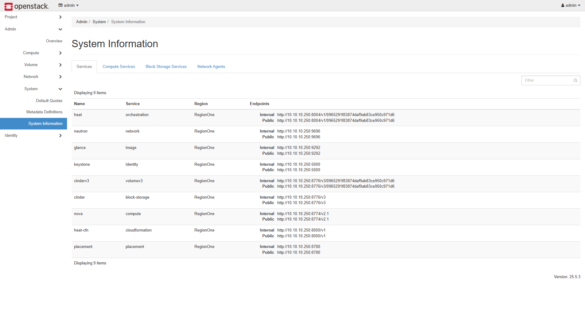
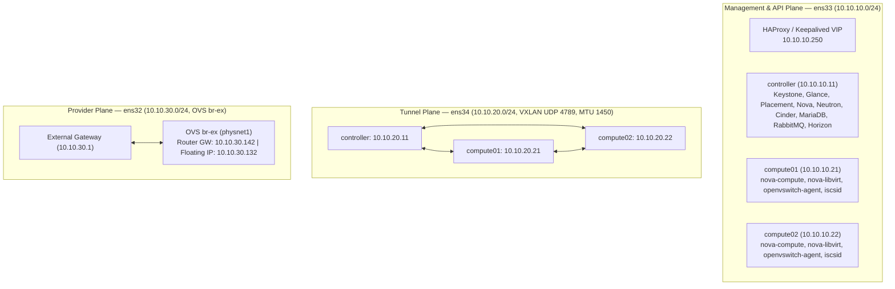

# OpenStack Multi-Node Private Cloud

Multi-node OpenStack private cloud deployment configurations, network architecture, and verification logs across two builds:

1. **Kolla-Ansible Multi-Plane Deployment (OpenStack 2025.2 Flamingo on Ubuntu 24.04 LTS):** Three nodes (`controller`, `compute01`, `compute02`) segmented across three network interfaces (`ens33` Management + HAProxy/Keepalived VIP `10.10.10.250`, `ens34` VXLAN Tunnel `MTU 1450`, and `ens32` Flat Provider `br-ex`), two active KVM hypervisors, Cinder LVM/iSCSI volume attachment, and Open vSwitch fault-testing.
2. **Manual Package Baseline (OpenStack 2024.1 Caracal on Ubuntu 22.04 LTS):** Package-by-package deployment across five logical roles (`controller`, `compute1`, `compute2`, `block`, `object`) with manual service configuration, Open vSwitch bridges, Cinder LVM/iSCSI, and Swift object storage.

---

## Comparison: Manual Baseline vs. Kolla-Ansible Build

| Dimension | Generation 1 (Manual Baseline) | Generation 2 (Kolla-Ansible Build) |
|---|---|---|
| **Release & OS** | OpenStack 2024.1 Caracal on Ubuntu 22.04 LTS | OpenStack 2025.2 Flamingo on Ubuntu 24.04.5 LTS |
| **Deployment Model** | Manual APT packages & `.conf` files | Kolla-Ansible `21.3.0` (55 Docker containers) |
| **API Endpoint** | Single controller IP (`192.168.100.24`) | Keepalived + HAProxy + ProxySQL VIP (`10.10.10.250/32`) |
| **Network Layout** | Single shared NIC (`192.168.100.0/24` on `br-ex`) | 3 NICs per node: `ens33` Mgmt (`10.10.10.0/24`), `ens34` VXLAN (`10.10.20.0/24`), `ens32` Provider (`10.10.30.0/24`) |
| **Compute Nodes** | `compute1` active | `compute01` (`10.10.10.21`) and `compute02` (`10.10.10.22`) active (Nested KVM) |
| **East–West Overlay** | VXLAN `br-tun` over shared subnet | Dedicated `ens34` VXLAN mesh (`UDP 4789`, `MTU 1450`) |
| **North–South Routing** | Virtual router SNAT + Floating IPs | Neutron L3 router DNAT/SNAT + Floating IP `10.10.30.132` |
| **Block Storage** | Cinder LVM/iSCSI (`cinder-volumes`) | Cinder Thin-Pool LVM (`controller@lvm-1` on `/dev/sdb`, 20 GiB) |

### Horizon Dashboard (OpenStack 2025.2 Flamingo)



*Network topology (`http://10.10.10.250`): external provider network `public-net` (`10.10.30.0/24`) routed via `demo-router` to VXLAN tenant network `private-net` (`192.168.100.0/24`) with instances across `compute01` and `compute02`.*

<table>
<tr>
<td width="50%">

<br><sub><b>Instances</b> — <code>cirros-vm-01</code> (<code>compute01</code>, FIP <code>10.10.30.132</code>) and <code>cirros-vm-02</code> (<code>compute02</code>, <code>192.168.100.218</code>).</sub>
</td>
<td width="50%">

<br><sub><b>Hypervisors</b> — <code>compute01</code> and <code>compute02</code> registered in Nova.</sub>
</td>
</tr>
<tr>
<td width="50%">

<br><sub><b>Block Storage</b> — 1 GiB LVM/iSCSI volume <code>demo-vol-01</code> attached to <code>cirros-vm-01</code> on <code>/dev/vdb</code>.</sub>
</td>
<td width="50%">

<br><sub><b>System Services</b> — Control-plane endpoints, compute services, and Neutron agents on VIP <code>10.10.10.250</code>.</sub>
</td>
</tr>
</table>

---

## Architecture

### Three-Plane Network Topology (`10.10.10.0/24`, `10.10.20.0/24`, `10.10.30.0/24`)



### Node Inventory

| Hostname | Role(s) | RAM | vCPU | Mgmt IP (`ens33`) | Tunnel IP (`ens34`) | External NIC (`ens32`) | Storage |
| :--- | :--- | :--- | :--- | :--- | :--- | :--- | :--- |
| `controller` | Control, Network, Storage | 5.0 GiB | 2 | `10.10.10.11/24` (VIP `.250`) | `10.10.20.11/24` | Bridged in `br-ex` | `sda` (23G root) + `sdb` (20G `cinder-volumes` VG) |
| `compute01` | KVM Hypervisor + OVS Agent | 2.5 GiB | 2 | `10.10.10.21/24` | `10.10.20.21/24` | Bridged in `br-ex` | `sda` (23G root) |
| `compute02` | KVM Hypervisor + OVS Agent | 2.5 GiB | 2 | `10.10.10.22/24` | `10.10.20.22/24` | Bridged in `br-ex` | `sda` (23G root) |

---

## Documentation & Verification Logs

Runbooks are in [`docs/`](docs/) and terminal captures are in [`evidence/`](evidence/):

- [`docs/01-host-and-network-setup.md`](docs/01-host-and-network-setup.md) — Host preparation, 3-NIC netplan setup, and LVM resizing ([`evidence/00-env-discovery.txt`](evidence/00-env-discovery.txt))
- [`docs/02-linux-cgroups-and-lvm.md`](docs/02-linux-cgroups-and-lvm.md) — Cinder `cinder-volumes` VG setup and Cgroups v2 memory limits ([`evidence/01-week1-linux-lvm-cgroups.txt`](evidence/01-week1-linux-lvm-cgroups.txt))
- [`docs/03-sdn-namespaces-vxlan.md`](docs/03-sdn-namespaces-vxlan.md) — Linux network namespaces, VXLAN encapsulation, and 1450 MTU testing ([`evidence/02-week2-sdn-vxlan-mtu.txt`](evidence/02-week2-sdn-vxlan-mtu.txt))
- [`docs/04-kolla-ansible-deployment.md`](docs/04-kolla-ansible-deployment.md) — Kolla-Ansible deployment and control-plane checks ([`evidence/03-kolla-control-plane.txt`](evidence/03-kolla-control-plane.txt))
- [`docs/05-workloads-and-failure-drills.md`](docs/05-workloads-and-failure-drills.md) — Instance provisioning, Cinder volume attach, cross-node VXLAN ping, and OVS failure tests ([`evidence/04-workloads-and-drills.txt`](evidence/04-workloads-and-drills.txt))

### Sample CLI Verification

```text
$ openstack compute service list
+--------------------------------------+----------------+------------+----------+---------+-------+----------------------------+
| ID                                   | Binary         | Host       | Zone     | Status  | State | Updated At                 |
+--------------------------------------+----------------+------------+----------+---------+-------+----------------------------+
| 8015d4d8-f2fe-46ac-8791-b18b815539e2 | nova-scheduler | controller | internal | enabled | up    | 2026-11-05T04:08:06.000000 |
| 6849074c-0618-4e76-a0be-f166c0b2e124 | nova-conductor | controller | internal | enabled | up    | 2026-11-05T04:08:07.000000 |
| 676b96b7-6aa0-4fe4-9921-800eba2c4c73 | nova-compute   | compute01  | nova     | enabled | up    | 2026-11-05T04:08:08.000000 |
| dda5bbf5-9e78-44a2-af52-0bc5a02468f5 | nova-compute   | compute02  | nova     | enabled | up    | 2026-11-05T04:08:04.000000 |
+--------------------------------------+----------------+------------+----------+---------+-------+----------------------------+

$ openstack server list --long
+--------------------------------------+--------------+--------+------------+-------------+-------------------------------------------+--------------+---------+-----------+-------------+
| ID                                   | Name         | Status | Task State | Power State | Networks                                  | Image Name   | Flavor  | Host      | Host Status |
+--------------------------------------+--------------+--------+------------+-------------+-------------------------------------------+--------------+---------+-----------+-------------+
| dd5278d2-d9a7-4993-b231-5ded1a26b829 | cirros-vm-02 | ACTIVE | None       | Running     | private-net=192.168.100.218               | cirros-0.6.2 | m1.tiny | compute02 | UP          |
| 5f64ee18-3910-4d07-bece-3ee941b6889f | cirros-vm-01 | ACTIVE | None       | Running     | private-net=10.10.30.132, 192.168.100.237 | cirros-0.6.2 | m1.tiny | compute01 | UP          |
+--------------------------------------+--------------+--------+------------+-------------+-------------------------------------------+--------------+---------+-----------+-------------+
```

---

## Troubleshooting Notes

| Issue | Cause | Check / Fix |
|---|---|---|
| Instance stuck in `BUILD`, port `binding:failed` | OVS agent down or `bridge_mappings` mismatch | `openstack network agent list`, `docker exec openvswitch_vswitchd ovs-vsctl show` |
| Instance `ACTIVE` but no DHCP lease | `qdhcp` namespace missing or `dnsmasq` down | `ip netns list`, `docker logs neutron_dhcp_agent` |
| Floating IP unreachable from host | `br-ex` physical port (`ens32`) down or missing route | `ip -br link show ens32`, `ip netns exec qrouter-... iptables -t nat -S` |
| Volume stays in `attaching` | `tgtd` / `iscsid` conflict or missing `cinder-volumes` VG | `vgs cinder-volumes`, `docker logs cinder_volume`, `docker logs iscsid` |
| ICMP works, SSH/TLS hangs | VXLAN 50-byte encapsulation exceeding 1500 MTU | Set guest `eth0` MTU to `1450`; test with `ping -M do -s 1422` |

---

## License

MIT — see [LICENSE](LICENSE).
