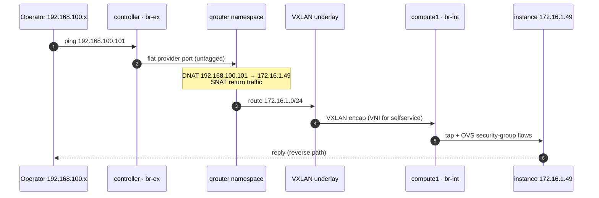

# OpenStack Caracal — 5-Node Private Cloud

A hands-on OpenStack 2024.1 (Caracal) deployment on Ubuntu 22.04 LTS: **three physical
nodes** (`controller`, `compute1`, `compute2`) and **two virtual nodes** (`block`, `object`).
The controller runs the control plane *and* the Neutron network services; the computes run
KVM and the OVS overlay agents; `block` provides Cinder LVM/iSCSI storage; `object` provides
Swift object storage.

The repository is a complete, reproducible build guide: every non-default configuration is
committed, the topology and packet paths are drawn out, and the acceptance checks are
scripted so the result can be verified rather than taken on trust.


[](https://github.com/whysari/openstack-caracal-multinode/actions/workflows/validate.yml)
[](https://github.com/whysari/openstack-caracal-multinode)

---

## At a glance

| | |
|---|---|
| **Release** | OpenStack 2024.1 Caracal (Ubuntu Cloud Archive) |
| **OS** | Ubuntu Server 22.04 LTS |
| **Nodes** | 5 — 3 physical (`controller`, `compute1`, `compute2`) + 2 virtual (`block`, `object`) |
| **Control plane** | Keystone, Glance, Placement, Nova, Neutron, Cinder, Swift, Horizon |
| **SDN** | Neutron ML2 + Open vSwitch, VXLAN overlays (`1:1000`), L2 population |
| **East–west** | VXLAN tunnels over `192.168.100.0/24` (`br-tun`) |
| **North–south** | Flat provider network `192.168.100.0/24`, virtual router, SNAT + floating IPs `.101–.250` |
| **Block storage** | Cinder LVM over iSCSI (`tgt`), VG `cinder-volumes` on `block` |
| **Object storage** | Single-node Swift (`object`), 4 devices, 3 replicas, Keystone auth |
| **Acceptance gate** | [`scripts/20-smoke-test.sh`](scripts/20-smoke-test.sh) |

> **Lab, not production.** This is a learning and portfolio deployment: one controller, one
> storage node per storage service, and no control-plane HA. The design decisions and the
> production path are documented at the end.

### From the lab


*Live Horizon view from the cluster: provider network `192.168.100.0/24`, router
`192.168.100.223`, tenant gateway `172.16.1.1`, and `selfservice-demo0` at `172.16.1.49`.*

---

## Architecture

### Logical topology


A Mermaid source of the same topology is kept in
[`diagrams/architecture.mmd`](diagrams/architecture.mmd) for editing as code.

### Node roles

| Host | Type | Address | Services |
|---|---|---|---|
| `controller` | physical | `192.168.100.24` | Keystone, Glance, Placement, Nova API/scheduler/conductor/novncproxy, Neutron server + OVS/L3/DHCP/metadata agents, Cinder API/scheduler, Swift proxy, Horizon, MariaDB, RabbitMQ, Memcached, Etcd |
| `compute1` | physical | `192.168.100.25` | `nova-compute`, KVM/libvirt, Neutron OVS agent; hosted `selfservice-demo0` |
| `compute2` | physical | `192.168.100.26` | `nova-compute`, KVM/libvirt, Neutron OVS agent |
| `block` | virtual | `192.168.100.27` | `cinder-volume`, LVM VG `cinder-volumes`, `tgt` iSCSI target |
| `object` | virtual | `192.168.100.28` | Swift account/container/object servers, four devices under `/srv/node`, rsync daemon (no peers yet) |

There is **no separate network node**. The controller is the network node: it owns `br-ex`,
the VXLAN tunnel endpoint, the router namespace, the DHCP namespace and the metadata proxy.
This is the standard install-guide layout collapsed onto one host.

### Network planes

| Plane | Subnet | Purpose |
|---|---|---|
| Management + provider | `192.168.100.0/24` | Host management, API endpoints, SQL/AMQP, VXLAN underlay, flat provider network, floating IPs `.101–.250` |
| Tenant overlay | `172.16.1.0/24` | Self-service VXLAN network `selfservice`, gateway `172.16.1.1` |

> **Single-NIC simplification:** management and provider traffic share the same L2 segment.
> The controller's physical NIC is enslaved to `br-ex`, and `192.168.100.24` lives on the
> bridge. In production these planes would be separated, and the provider bridge would use a
> dedicated NIC.

### How a floating-IP packet moves



The router namespace on the controller owns the floating IP and performs DNAT/SNAT. Compute
nodes never see the provider network; only the controller has `br-ex`.

### Storage paths

| Path | Flow |
|---|---|
| Cinder attach | `nova-compute` → Cinder API → `block` `cinder-volume` → LVM volume exported by `tgt` on TCP/3260 → QEMU on the compute |
| Swift object | client → `controller:8080` Swift proxy (Keystone auth) → `object:6000/6001/6002` account/container/object servers → `/srv/node/{1..4}` |

---

## IP plan

| Object | Value |
|---|---|
| Provider network | `192.168.100.0/24`, gateway `192.168.100.1` |
| Floating IP pool | `192.168.100.101 – 192.168.100.250` |
| Host addresses | `.24 controller`, `.25 compute1`, `.26 compute2`, `.27 block`, `.28 object` |
| Self-service network | `172.16.1.0/24`, gateway `172.16.1.1` |
| Demo instance | `selfservice-demo0`, `172.16.1.49`, flavor `m1.nano`, host `compute1` |
| VXLAN VNI range | `1:1000` |

The host addresses are outside the floating-IP allocation pool, so they cannot collide with
instance floating IPs.

---

## Repository layout

```
.
├── README.md
├── configs/
│   ├── controller/           # Keystone, Glance, Placement, Nova, Neutron, Cinder, Horizon, Swift proxy, Etcd
│   ├── compute1/             # nova.conf, neutron.conf, openvswitch_agent.ini (.25)
│   ├── compute2/             # same, with .26
│   ├── block/                # cinder.conf ([lvm]), lvm.conf filter, tgt include
│   ├── object/swift/         # account/container/object servers, swift.conf, rsyncd.conf
│   ├── netplan/              # per-host static addressing; controller uses br-ex
│   ├── ovs/                  # br-ex bootstrap/recovery fallback
│   ├── sysctl/               # forwarding and rp_filter
│   └── hosts                 # /etc/hosts for all five nodes
├── diagrams/                 # architecture SVG/PNG + Mermaid sources
├── docs/                     # build notes, verification, troubleshooting, completion guide
├── scripts/                  # preflight, networks, smoke test, evidence, teardown
└── evidence/                 # captured verification output
```

Credentials in committed files are placeholders (`*_PASS`, `*_DBPASS`, `CHANGE_ME_HASH_*`).
See [`configs/README.md`](configs/README.md).

---

## Build order

Each phase ends with a verification gate. Do not continue until the gate passes — most
OpenStack failures are an earlier layer surfacing late.

| # | Phase | Doc | Gate |
|---|---|---|---|
| 00 | Host prep, netplan, `br-ex`, NTP | [docs/01-host-preparation.md](docs/01-host-preparation.md) | All five hosts resolve; controller has `br-ex` with `.24` |
| 01 | MariaDB, RabbitMQ, Memcached, Etcd, Keystone | [docs/02-keystone.md](docs/02-keystone.md) | `openstack token issue` |
| 02 | Glance + Placement | [docs/03-glance-placement.md](docs/03-glance-placement.md) | Image `active`; Placement responds |
| 03 | Nova control plane + computes | [docs/04-nova.md](docs/04-nova.md) | `openstack compute service list` — conductor, scheduler, compute1, compute2 up |
| 04 | Neutron ML2/OVS + L3/DHCP/metadata | [docs/05-neutron.md](docs/05-neutron.md) | `openstack network agent list` — six agents up |
| 05 | Cinder LVM/iSCSI on `block` | [docs/06-cinder.md](docs/06-cinder.md) | `cinder-volume` on `block@lvm` up; volume reaches `available` |
| 06 | Swift proxy + rings | [docs/07-swift.md](docs/07-swift.md) | Object PUT/GET round-trip; ring 10 partitions / 3 replicas / 4 devices |
| 07 | Horizon | [docs/08-horizon.md](docs/08-horizon.md) | Login and launch from the dashboard |
| 08 | End-to-end acceptance | [docs/09-verification.md](docs/09-verification.md) | `scripts/20-smoke-test.sh` exits 0 |
| 09 | Bring both computes into service | [docs/11-completing-the-build.md](docs/11-completing-the-build.md) | Both compute services and OVS agents up |

### Base packages (all nodes)

```bash
sudo apt update && sudo apt upgrade -y
sudo apt install -y software-properties-common chrony
sudo add-apt-repository -y cloud-archive:caracal
sudo apt update && sudo apt install -y python3-openstackclient
```

Pin the release so a later `apt upgrade` does not drag the cluster onto a newer OpenStack:

```bash
sudo apt-mark hold 'python3-*openstack*' 'nova-*' 'neutron-*' 'cinder-*' 'swift-*' \
  'keystone' 'glance' 'placement-*' 'openstack-dashboard'
```

---

## Key configuration

Full files live in [`configs/`](configs/). The four that define this deployment's behaviour:

### ML2 — drivers and overlay range

```ini
# /etc/neutron/plugins/ml2/ml2_conf.ini (controller)
[ml2]
type_drivers = flat,vlan,vxlan
tenant_network_types = vxlan
mechanism_drivers = openvswitch,l2population
extension_drivers = port_security
path_mtu = 1500

[ml2_type_flat]
flat_networks = provider

[ml2_type_vxlan]
vni_ranges = 1:1000
```

### OVS agent — controller and computes

```ini
# /etc/neutron/plugins/ml2/openvswitch_agent.ini (controller)
[ovs]
bridge_mappings = provider:br-ex
local_ip = 192.168.100.24

[agent]
tunnel_types = vxlan
l2_population = true
```

Computes use the same file **without** `bridge_mappings`:

```ini
# compute1
[ovs]
local_ip = 192.168.100.25
```

### Cinder — LVM backed by iSCSI

```ini
# /etc/cinder/cinder.conf (block)
[DEFAULT]
enabled_backends = lvm
my_ip = 192.168.100.27

[lvm]
volume_driver = cinder.volume.drivers.lvm.LVMVolumeDriver
volume_group = cinder-volumes
target_protocol = iscsi
target_helper = tgtadm
volume_backend_name = lvm
```

Create the backend before starting the service:

```bash
sudo pvcreate /dev/sdb
sudo vgcreate cinder-volumes /dev/sdb
sudo systemctl enable --now tgt
```

The LVM filter in [`configs/block/lvm.conf`](configs/block/lvm.conf) only accepts `sda` and
`sdb`; this prevents LVM from scanning the iSCSI volumes Cinder creates.

### Swift — single node, four devices

```bash
# on the object node, after creating /srv/node/{1,2,3,4}
cd /etc/swift
swift-ring-builder account.builder create 10 3 1
swift-ring-builder container.builder create 10 3 1
swift-ring-builder object.builder create 10 3 1

for dev in 1 2 3 4; do
  for ring in account:6002 container:6001 object:6000; do
    name="${ring%%:*}"; port="${ring##*:}"
    swift-ring-builder "${name}.builder" add \
      --region 1 --zone 1 --ip 192.168.100.28 --port "$port" \
      --device "$dev" --weight 100
  done
done

for b in *.builder; do swift-ring-builder "$b" rebalance; done
```

The four devices are directories on one node, so the three replicas are spread across four
directories but **not across failure domains**. Adding `object2`/`object3` later only requires
new devices and a ring rebalance; see the roadmap.

> **Proxy placement.** The Swift proxy runs on the controller (`controller:8080`) and the data
> servers run on `object`. This matches the Keystone object-store endpoints and the captured
> `openstack object create` path in the lab. The lab notes also contain an earlier
> `tempauth` proxy attempt; the working configuration here is Keystone auth.

---

## Verification

All commands assume `source ~/admin-openrc` and run from `controller`.

### 1. Control plane

```bash
openstack compute service list
openstack network agent list
openstack volume service list
```

Expected:

- `nova-conductor`, `nova-scheduler` on `controller` — up.
- `nova-compute` on `compute1` and `compute2` — up.
- Six Neutron agents: OVS + L3 + DHCP + metadata on `controller`, OVS on `compute1` and
  `compute2` — all alive.
- `cinder-scheduler` on `controller`, `cinder-volume` on `block@lvm` — up.

### 2. OVS data path

```bash
# controller
sudo ovs-vsctl show
sudo ovs-vsctl list-br          # br-ex br-int br-tun
sudo ovs-vsctl list-ports br-ex # the physical NIC

# compute1 / compute2
sudo ovs-vsctl show
sudo ovs-vsctl list-br          # br-int br-tun
```

The controller's `br-ex` carries `192.168.100.24/24`; the router namespace adds the floating
IPs on top of the same bridge.

### 3. Namespaces and routing

```bash
# controller
sudo ip netns
# qrouter-<router-uuid>
# qdhcp-<selfservice-net-uuid>

sudo ip netns exec qrouter-<uuid> ip -4 addr show
sudo ip netns exec qrouter-<uuid> ip route
sudo ip netns exec qrouter-<uuid> iptables -t nat -S | grep -E 'SNAT|DNAT'
```

Expected: the router holds `172.16.1.1/24` on the tenant side and a floating IP on the provider
side; NAT rules map `172.16.1.0/24` to the router's external address and DNAT each floating IP
to its fixed IP.

### 4. Instance, floating IP, SSH

```bash
openstack server list
openstack floating ip list
ping -c3 192.168.100.101
ssh cirros@192.168.100.101      # CirrOS default password: gocubsgo
```

The controller is on the provider LAN, so these checks run directly from it.

### 5. Volume attach

```bash
openstack volume create --size 1 demo-vol
openstack server add volume selfservice-demo0 demo-vol
openstack volume show demo-vol -c status -c attachments
# status: in-use, attached to selfservice-demo0
```

Inside the guest, the volume appears as a second virtio disk (`/dev/vdb` on most images).

### 6. Swift round-trip

```bash
openstack container create demo-container
openstack object create demo-container README.md
openstack object list demo-container
openstack object save demo-container README.md --file /tmp/README.roundtrip.md
md5sum README.md /tmp/README.roundtrip.md
swift-ring-builder /etc/swift/object.builder
```

Expected: matching hashes and a ring with `10 partitions, 3.000000 replicas, 1 zones,
4 devices`.

### Acceptance checks

[`scripts/20-smoke-test.sh`](scripts/20-smoke-test.sh) runs the whole matrix and exits non-zero
on the first failed layer. It creates a disposable `smoke-01` instance, a floating IP, a 1 GiB
volume and a Swift container; [`scripts/99-teardown.sh`](scripts/99-teardown.sh) removes them.

| # | Check | Pass criterion |
|---|---|---|
| 1 | Keystone | `openstack token issue` returns a token |
| 2 | Nova | conductor, scheduler and at least one compute up |
| 3 | Neutron | every agent alive |
| 4 | Cinder | `cinder-volume` up |
| 5 | Networks | `provider` + `selfservice` + `router` present |
| 6 | Instance | `smoke-01` reaches `ACTIVE` on `selfservice` |
| 7 | DHCP | fixed IPv4 in `172.16.1.0/24` |
| 8 | Floating IP | ICMP reply from the controller |
| 9 | SSH + metadata | SSH works; `169.254.169.254` returns the instance ID |
| 10 | Volume | 1 GiB volume reaches `in-use` |
| 11 | Swift | object PUT/GET byte-identical |
| 12 | Swift ring | 10 partitions / 3 replicas / 4 devices |

### Lab evidence

These screenshots are from the May 2025 lab run on the five nodes. They show the real
hostnames, addresses and service state; `compute2` was intentionally stopped for the demo.

<table>
<tr>
<td width="50%">

<br><sub><b>Keystone</b> — scoped token for <code>myuser</code> in <code>myproject</code>;
identity endpoint <code>controller:5000/v3</code>.</sub>
</td>
<td width="50%">

<br><sub><b>Glance</b> — CirrOS image registered and returned by <code>glance image-list</code>.</sub>
</td>
</tr>
<tr>
<td width="50%">

<br><sub><b>Placement</b> — <code>placement-status upgrade check</code> reports success for all
three checks.</sub>
</td>
<td width="50%">

<br><sub><b>Nova</b> — conductor and scheduler up on <code>controller</code>; <code>compute1</code>
up and hosting the demo. <code>compute2</code> is intentionally stopped; the stale
<code>controller</code> compute record is a leftover.</sub>
</td>
</tr>
<tr>
<td width="50%">

<br><sub><b>Neutron</b> — DHCP, L3, metadata and OVS agents up on <code>controller</code>; OVS on
<code>compute1</code> up. <code>compute2</code> OVS is intentionally down (<code>XXX</code>).</sub>
</td>
<td width="50%">

<br><sub><b>Horizon</b> — dashboard login served from <code>controller/horizon</code>.</sub>
</td>
</tr>
<tr>
<td width="50%">

<br><sub><b>Cinder</b> — <code>cinder-scheduler</code> on <code>controller</code> and
<code>cinder-volume</code> on <code>block@lvm</code> both <code>up</code>.</sub>
</td>
<td width="50%">

<br><sub><b>Swift</b> — <code>swift stat</code>, container create, object create and object list
through the Keystone-authenticated proxy.</sub>
</td>
</tr>
<tr>
<td width="50%">

<br><sub><b>API access</b> — the service catalog (<code>Displaying 7 items</code>) with the
compute, identity, image, network, placement and volume endpoints.</sub>
</td>
<td width="50%">

<br><sub><b>Instances</b> — <code>selfservice-demo0</code> Active at <code>172.16.1.49</code>,
flavor <code>m1.nano</code>, key pair <code>mykey</code>.</sub>
</td>
</tr>
<tr>
<td width="50%">

<br><sub><b>Instance detail</b> — <code>selfservice-demo0</code> on <code>compute1</code>;
status, project and host confirmed in Horizon.</sub>
</td>
<td width="50%">

<br><sub><b>Console</b> — <code>ping 8.8.8.8</code> from the guest succeeds through the
router/SNAT path.</sub>
</td>
</tr>
</table>

### Capture notes

The screenshots above are from the May 2025 lab run. `compute2` was intentionally stopped for
the demo, so its `nova-compute` and OVS agent show down; `compute1` stayed up and hosted
`selfservice-demo0` (created 22 hours earlier, still `ACTIVE`). The stale `controller`
`nova-compute` record is also visible in the Nova list; it is not part of this design.

The capture covers Keystone, Glance, Placement, Nova, Neutron, Horizon, Cinder (`block@lvm`),
Swift and the instance console. It does not include a floating-IP/SSH test or a volume attach;
those are covered by [`scripts/20-smoke-test.sh`](scripts/20-smoke-test.sh). To reproduce the
full two-compute state, start `compute2` with
[docs/11-completing-the-build.md](docs/11-completing-the-build.md), run the smoke test, and
commit the fresh output under `evidence/`.

---

## Troubleshooting notes

| Symptom | Likely cause | Fix |
|---|---|---|
| Instance stuck `BUILD`, port `binding:failed` | OVS agent down or `bridge_mappings` mismatch | `openstack network agent list`, `journalctl -u neutron-openvswitch-agent` |
| Instance `ACTIVE` but no DHCP | `qdhcp` namespace missing / dnsmasq dead | `ip netns`, `journalctl -u neutron-dhcp-agent`, check `[dhcp] interface_driver` |
| Metadata 500 / no `169.254.169.254` | Secret mismatch between Nova and metadata agent | Compare `metadata_proxy_shared_secret` in `nova.conf` and `metadata_agent.ini` |
| Floating IP unreachable | `br-ex` mapping, missing gateway, or `rp_filter` | `ovs-vsctl show`, `ip netns exec qrouter-… ip route`, `sysctl net.ipv4.ip_forward` |
| Volume attach fails | `tgt` down, wrong target IP, IQN ACL | `systemctl status tgt`, `tgtadm --mode target --op show`, `cinder-volume` logs |
| Swift 503 | Ring not rebalanced or `/srv/node/N` missing | `swift-ring-builder …`, `swift-init all status`, `ls /srv/node` |
| `AMQPChannelAddressError` | RabbitMQ down or wrong `transport_url` | `rabbitmqctl status`, `rabbitmqctl list_users` |
| SSH to instance times out but ping works | Security group lacks TCP/22 | `openstack security group rule create --proto tcp --dst-port 22 default` |
| MTU-related hangs on large packets | VXLAN overhead with 1500-byte underlay | Set `path_mtu = 1500`; verify guest MTU 1450 via DHCP |

More detail: [`docs/10-troubleshooting.md`](docs/10-troubleshooting.md).

---

## Design decisions and trade-offs

1. **ML2/OVS instead of OVN.** The goal was to operate the classic OVS/VXLAN data path —
   bridges, patch ports, tunnel endpoints, namespaces — rather than let OVN hide it. Trade-off:
   more agents and namespaces, no OVN-style distributed routing.
2. **Controller doubles as network node.** The real cluster has three physical hosts, so L3,
   DHCP, metadata and `br-ex` live on the controller. Trade-off: a single north–south choke
   point and more services on one host.
3. **Single controller.** No HA; Galera, RabbitMQ quorum queues and HAProxy/Keepalived are the
   documented next step, not something this repo pretends to have.
4. **LVM/iSCSI for Cinder.** Real block semantics with no extra hardware. Trade-off: no
   replication; snapshots are local to `block`.
5. **Single-node Swift with four devices.** A real Swift ring, proxy and Keystone auth on one
   node. Trade-off: three replicas share one failure domain; node-level redundancy requires
   additional object nodes.

### Known limitations

- Single controller and single network path — no control-plane or L3 HA.
- Swift data lives on one node; the ring is not fault-tolerant against node loss.
- Cinder is a single LVM backend; no replication.
- Management and provider networks share `192.168.100.0/24`; no dedicated provider NIC.
- No TLS on the internal API network; lab credentials only.
- No Ceph, Octavia, Telemetry or centralised logging yet.

---

## Roadmap

- [ ] Three-controller HA: Galera, RabbitMQ quorum queues, HAProxy + Keepalived, Etcd for
      Cinder active-active coordination.
- [ ] Add `object2`/`object3`, rebalance the rings across three zones, and test node failure.
- [ ] Add a second Cinder backend or Ceph RBD for replication.
- [ ] Separate management, provider and VXLAN tunnel networks onto dedicated NICs.
- [ ] Prometheus + Grafana + Loki for cluster observability.
- [ ] Re-deploy with Kolla-Ansible and compare against this hand-built baseline.
- [ ] Terraform the instance/network layer on top of the cloud.

---

## References

- [OpenStack Caracal install guide (Ubuntu)](https://docs.openstack.org/2024.1/install/)
- [Neutron OVS self-service networks](https://docs.openstack.org/neutron/2024.1/admin/deploy-ovs-selfservice.html)
- [Swift deployment and rings](https://docs.openstack.org/swift/2024.1/install/)
- [Cinder LVM driver](https://docs.openstack.org/cinder/2024.1/configuration/block-storage/drivers/lvm-volume-driver.html)

---

## Context and author

Built in 2025 as a hands-on private-cloud lab: five nodes, a real OpenStack Caracal control
plane, OVS/VXLAN networking, LVM/iSCSI block storage and a Swift object store. This repository
is the English technical documentation and reproducible build guide.

**Ragchaa Battsengel** — Ulaanbaatar, Mongolia

- GitHub: [@whysari](https://github.com/whysari)
- LinkedIn: [ragchaa-battsengel](https://www.linkedin.com/in/ragchaa-battsengel-79b6183bb)
- Email: ari.whysari@gmail.com

## License

MIT — see [LICENSE](LICENSE).
