# OpenStack Multi-Node Private Cloud — Manual Baseline to Kolla-Ansible Production Architecture

A hands-on multi-node OpenStack private-cloud engineering repository documenting **two complete generations of deployment**:

1. **Generation 2 — Containerized Multi-Plane Build (OpenStack 2025.2 Flamingo + Kolla-Ansible on Ubuntu 24.04.5 LTS):** Three nodes (`controller`, `compute01`, `compute02`) segmented across **three dedicated network planes** (`ens33` Management + HAProxy/Keepalived VIP `10.10.10.250`, `ens34` VXLAN Tunnel `MTU 1450`, and `ens32` Flat Provider `br-ex`), with **both KVM hypervisors active**, cross-node East–West VXLAN verification, North–South Floating IP SSH, Cinder LVM thin-pool iSCSI `/dev/vdb` volume attachment, Cgroups v2 `CONSTRAINT_MEMCG` isolation, and OVS control-plane vs. data-plane fault-injection drills.
2. **Generation 1 — Hand-Built Package Baseline (OpenStack 2024.1 Caracal on Ubuntu 22.04 LTS):** Package-by-package baseline across five logical roles (`controller`, `compute1`, `compute2`, `block`, `object`) with manual `.conf` wiring, Open vSwitch bridges, Cinder LVM/iSCSI, and a 4-device Swift object ring.

Every configuration file, engineering runbook, and raw terminal verification capture (`evidence/`) is committed so the entire architecture can be inspected and reproduced rather than taken on trust.


-EE0000?logo=ansible&logoColor=white)


[](https://github.com/whysari/openstack-caracal-multinode)

---

## At a glance: Generation 1 (Manual Baseline) vs. Generation 2 (Kolla-Ansible Upgrade)

| Dimension | Generation 1 (Hand-Built Baseline) | Generation 2 (Kolla-Ansible Multi-Plane Upgrade) |
|---|---|---|
| **Release & OS** | OpenStack 2024.1 Caracal on Ubuntu 22.04 LTS | **OpenStack 2025.2 Flamingo on Ubuntu 24.04.5 LTS (`6.8.0-147-generic`)** |
| **Deployment Model** | Manual APT packages & hand-written `.conf` files | **Kolla-Ansible `21.3.0` (`ansible-core 2.19.15`), 55 Docker containers** |
| **API High Availability** | Single controller IP (`192.168.100.24`) | **Keepalived + HAProxy + ProxySQL Virtual IP (`10.10.10.250/32`)** |
| **Network Segmentation** | Single shared NIC (`192.168.100.0/24` on `br-ex`) | **3 Dedicated NICs per node:** `ens33` Mgmt (`10.10.10.0/24`), `ens34` VXLAN Tunnel (`10.10.20.0/24`), `ens32` Provider (`10.10.30.0/24` on `br-ex`) |
| **Hypervisors Active** | `compute1` active (`compute2` offline in baseline capture) | **Both `compute01` (`10.10.10.21`) and `compute02` (`10.10.10.22`) `UP` (Nested KVM `/dev/kvm`)** |
| **East–West Overlay** | VXLAN `br-tun` over shared subnet | **Dedicated `ens34` VXLAN mesh (`10.10.20.11/.21/.22`, `UDP 4789`, `MTU 1450` verified)** |
| **North–South Routing** | Virtual router SNAT + Floating IPs `.101–.250` | **`qrouter-fd19fb5e...` (`10.10.30.142`) DNAT/SNAT + verified Floating IP `10.10.30.132` SSH** |
| **Block Storage** | Cinder LVM/iSCSI (`cinder-volumes`) | **Cinder Thin-Pool LVM (`controller@lvm-1` on `/dev/sdb`, 20 GiB) attached to VM as `/dev/vdb`** |
| **Verification Evidence** | 13 Horizon & CLI screenshots (`docs/images/lab/`) | **5 raw terminal verification logs ([`evidence/00..04.txt`](evidence/)) + 6 runbooks ([`docs/01..06.md`](docs/))** |

### From the lab

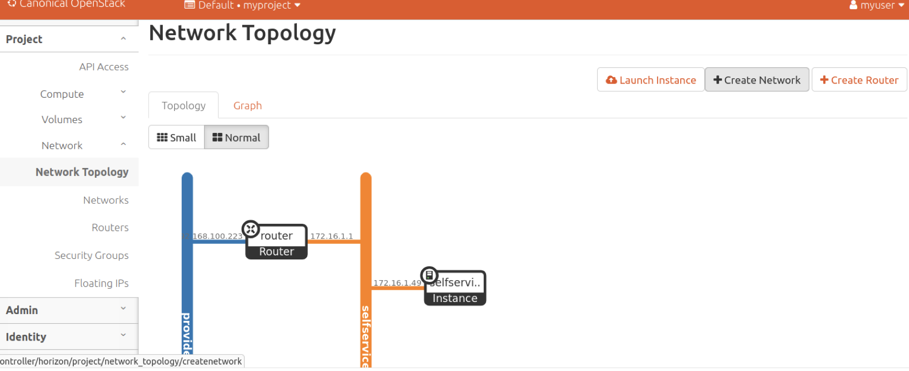

*Live Horizon Network Topology view: external provider network connected through the Neutron virtual router to the self-service VXLAN tenant network and active guest instances.*

---

## Architecture

### 1. Generation 2: Three-Plane Kolla-Ansible Topology (`10.10.10.0/24`, `10.10.20.0/24`, `10.10.30.0/24`)

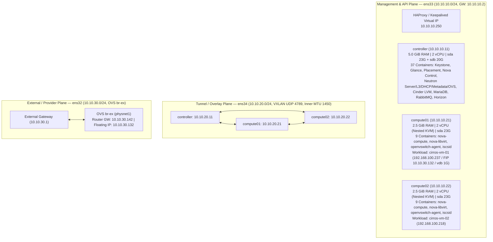

### 2. Generation 1: Logical 5-Role Diagram

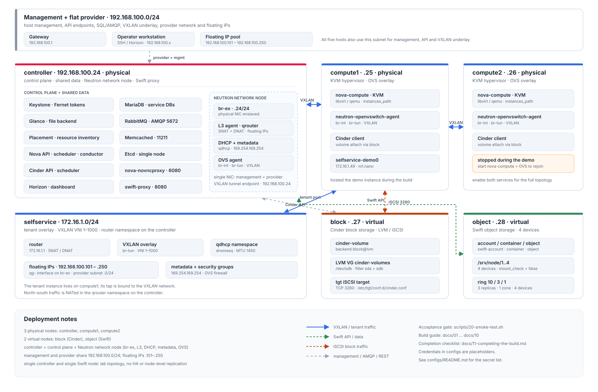

### Node Inventory (Generation 2 Live Cluster)

| Hostname | Role(s) | RAM / Swap | vCPU | Mgmt IP (`ens33`) | Tunnel IP (`ens34`) | External NIC (`ens32`) | Storage Disks |
| :--- | :--- | :--- | :--- | :--- | :--- | :--- | :--- |
| **`controller`** | Control, Network, Storage (`controller@lvm-1`) | 5.0 GiB + `zram` | 2 (`VT-x`) | `10.10.10.11/24` (VIP `.250`) | `10.10.20.11/24` | Bridged in `br-ex` | `sda` (23G Root LV) + `sdb` (20G `cinder-volumes` VG) |
| **`compute01`** | Hypervisor #1 (KVM) + OVS Agent | 2.5 GiB + `zram` | 2 (`VT-x`) | `10.10.10.21/24` | `10.10.20.21/24` | Bridged in `br-ex` | `sda` (23G Root LV + `cirros-vm-01` + `/dev/vdb`) |
| **`compute02`** | Hypervisor #2 (KVM) + OVS Agent | 2.5 GiB + `zram` | 2 (`VT-x`) | `10.10.10.22/24` | `10.10.20.22/24` | Bridged in `br-ex` | `sda` (23G Root LV + `cirros-vm-02`) |

---

## How a Floating-IP & Cross-Node VXLAN Packet Moves

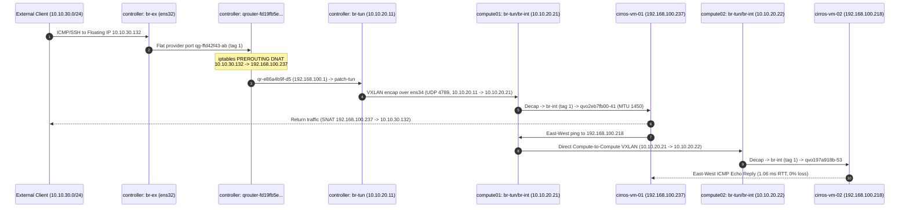

---

## Live Cluster Verification (Generation 2 — OpenStack 2025.2 Flamingo)

Full unedited terminal captures from all three nodes are stored in [`evidence/`](evidence/):

| Stage | Engineering Runbook | Raw Verification Capture | Key Verified Proof |
| :--- | :--- | :--- | :--- |
| **01. Host & 3-Plane Network** | [`docs/01-host-and-network-setup.md`](docs/01-host-and-network-setup.md) | [`evidence/00-env-discovery.txt`](evidence/00-env-discovery.txt) | 3 Ubuntu 24.04.5 LTS nodes, `/dev/kvm` VT-x, 3 NICs (`ens33`, `ens34`, `ens32`), Root LV expanded `11.5G -> 23G`. |
| **02. Cgroups v2 & Cinder LVM** | [`docs/02-linux-cgroups-and-lvm.md`](docs/02-linux-cgroups-and-lvm.md) | [`evidence/01-week1-linux-lvm-cgroups.txt`](evidence/01-week1-linux-lvm-cgroups.txt) | `cinder-volumes` 20 GiB VG on `/dev/sdb`; Cgroups v2 `MemoryMax=32M` kernel OOM-kill (`CONSTRAINT_MEMCG`). |
| **03. Linux SDN & VXLAN Math** | [`docs/03-sdn-namespaces-vxlan.md`](docs/03-sdn-namespaces-vxlan.md) | [`evidence/02-week2-sdn-vxlan-mtu.txt`](evidence/02-week2-sdn-vxlan-mtu.txt) | Manual `ip netns`, `veth`, `vxlan100` (`UDP 4789`), FDB table, and `1450B` (`PASS`) vs `1500B` (`FAIL`) MTU proof. |
| **04. Kolla-Ansible Deploy** | [`docs/04-kolla-ansible-deployment.md`](docs/04-kolla-ansible-deployment.md) | [`evidence/03-kolla-control-plane.txt`](evidence/03-kolla-control-plane.txt) | 55 containers deployed (`failed=0`), VIP `10.10.10.250`, 2 KVM hypervisors UP, 6 Neutron agents UP, Cinder LVM UP. |
| **05. Workloads & Outage Drill** | [`docs/05-workloads-and-failure-drills.md`](docs/05-workloads-and-failure-drills.md) | [`evidence/04-workloads-and-drills.txt`](evidence/04-workloads-and-drills.txt) | `cirros-vm-01` (`compute01`, FIP `10.10.30.132`, `/dev/vdb` 1G) <-> `cirros-vm-02` (`compute02`) VXLAN ping + OVS fault drill. |
| **06. STAR Case Studies** | [`docs/06-troubleshooting-and-interview-star.md`](docs/06-troubleshooting-and-interview-star.md) | All Evidence Logs (`00`–`04`) | 4 production troubleshooting case studies in STAR format. |

### 1. Control Plane, Hypervisors & Neutron SDN Agents (`evidence/03-kolla-control-plane.txt`)

```text
$ openstack compute service list
+--------------------------------------+----------------+------------+----------+---------+-------+----------------------------+
| ID                                   | Binary         | Host       | Zone     | Status  | State | Updated At                 |
+--------------------------------------+----------------+------------+----------+---------+-------+----------------------------+
| 8015d4d8-f2fe-46ac-8791-b18b815539e2 | nova-scheduler | controller | internal | enabled | up    | 2026-11-05T04:08:06.000000 |
| 6849074c-0618-4e76-a0be-f166c0b2e124 | nova-conductor | controller | internal | enabled | up    | 2026-11-05T04:08:07.000000 |
| 676b96b7-6aa0-4fe4-9921-800eba2c4c73 | nova-compute   | compute01  | nova     | enabled | up    | 2026-11-05T04:08:08.000000 |
| dda5bbf5-9e78-44a2-af52-0bc5a02468f5 | nova-compute   | compute02  | nova     | enabled | up    | 2026-11-05T04:08:04.000000 |
+--------------------------------------+----------------+------------+----------+---------+-------+----------------------------+

$ openstack network agent list
+--------------------------------------+--------------------+------------+-------------------+-------+-------+---------------------------+
| ID                                   | Agent Type         | Host       | Availability Zone | Alive | State | Binary                    |
+--------------------------------------+--------------------+------------+-------------------+-------+-------+---------------------------+
| 693b750b-7521-4f5b-be05-acdc94e37436 | Open vSwitch agent | controller | None              | :-)   | UP    | neutron-openvswitch-agent |
| 728c624d-8d9a-4bd1-9fc0-452230b04b29 | Open vSwitch agent | compute02  | None              | :-)   | UP    | neutron-openvswitch-agent |
| 7aa42616-7eef-4ffe-9d6f-a9f1bddc0ced | L3 agent           | controller | nova              | :-)   | UP    | neutron-l3-agent          |
| 7bc2e4db-2bd5-4311-a767-e1c6019f06d0 | Open vSwitch agent | compute01  | None              | :-)   | UP    | neutron-openvswitch-agent |
| ebc7f808-7c21-440a-ac02-a399ca5f6abe | Metadata agent     | controller | None              | :-)   | UP    | neutron-metadata-agent    |
| fbb441b0-77ea-4a8a-8ed1-1407ced9fcaf | DHCP agent         | controller | nova              | :-)   | UP    | neutron-dhcp-agent        |
+--------------------------------------+--------------------+------------+-------------------+-------+-------+---------------------------+

$ openstack volume service list
+------------------+------------------+------+---------+-------+----------------------------+
| Binary           | Host             | Zone | Status  | State | Updated At                 |
+------------------+------------------+------+---------+-------+----------------------------+
| cinder-scheduler | controller       | nova | enabled | up    | 2026-11-05T04:08:09.000000 |
| cinder-volume    | controller@lvm-1 | nova | enabled | up    | 2026-11-05T04:08:12.000000 |
+------------------+------------------+------+---------+-------+----------------------------+
```

### 2. Multi-Node Instances, Cinder `/dev/vdb` Attach & Cross-Node VXLAN Ping (`evidence/04-workloads-and-drills.txt`)

```text
$ openstack server list --long
+--------------------------------------+--------------+--------+------------+-------------+-------------------------------------------+--------------+---------+-----------+-------------+
| ID                                   | Name         | Status | Task State | Power State | Networks                                  | Image Name   | Flavor  | Host      | Host Status |
+--------------------------------------+--------------+--------+------------+-------------+-------------------------------------------+--------------+---------+-----------+-------------+
| dd5278d2-d9a7-4993-b231-5ded1a26b829 | cirros-vm-02 | ACTIVE | None       | Running     | private-net=192.168.100.218               | cirros-0.6.2 | m1.tiny | compute02 | UP          |
| 5f64ee18-3910-4d07-bece-3ee941b6889f | cirros-vm-01 | ACTIVE | None       | Running     | private-net=10.10.30.132, 192.168.100.237 | cirros-0.6.2 | m1.tiny | compute01 | UP          |
+--------------------------------------+--------------+--------+------------+-------------+-------------------------------------------+--------------+---------+-----------+-------------+

$ openstack volume list
+--------------------------------------+-------------+--------+------+---------------------------------------+
| ID                                   | Name        | Status | Size | Attached to                           |
+--------------------------------------+-------------+--------+------+---------------------------------------+
| acf33885-2cb2-4538-a420-2e542cc7f748 | demo-vol-01 | in-use |    1 | Attached to cirros-vm-01 on /dev/vdb  |
+--------------------------------------+-------------+--------+------+---------------------------------------+

# SSH into cirros-vm-01 (compute01) via Floating IP 10.10.30.132, verify /dev/vdb, and ping cirros-vm-02 (compute02):
$ ssh cirros@10.10.30.132 "hostname && ip -br a show eth0 && lsblk && ping -c 3 192.168.100.218"
cirros-vm-01
eth0             UP             192.168.100.237/24 fe80::f816:3eff:fe29:606/64
NAME    MAJ:MIN RM  SIZE RO TYPE MOUNTPOINTS
vda     252:0    0    1G  0 disk
|-vda1  252:1    0 1015M  0 part /
`-vda15 252:15   0    8M  0 part
vdb     252:16   0    1G  0 disk
PING 192.168.100.218 (192.168.100.218) 56(84) bytes of data.
64 bytes from 192.168.100.218: icmp_seq=1 ttl=64 time=4.71 ms
64 bytes from 192.168.100.218: icmp_seq=2 ttl=64 time=1.06 ms
64 bytes from 192.168.100.218: icmp_seq=3 ttl=64 time=2.59 ms
--- 192.168.100.218 ping statistics ---
3 packets transmitted, 3 received, 0% packet loss, time 2004ms
```

---

## Visual Lab Evidence Gallery (Generation 1 Baseline Captures)

These 12 captures from the Generation 1 baseline run illustrate the core OpenStack service verification gates, Horizon views, Swift object round-trip, and guest console checks:

<table>
<tr>
<td width="50%">
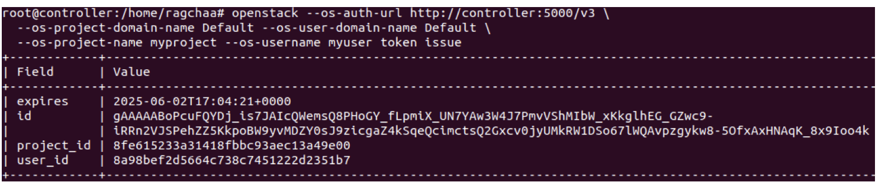
<br><sub><b>Keystone</b> — scoped token issue against identity endpoint <code>:5000/v3</code>.</sub>
</td>
<td width="50%">
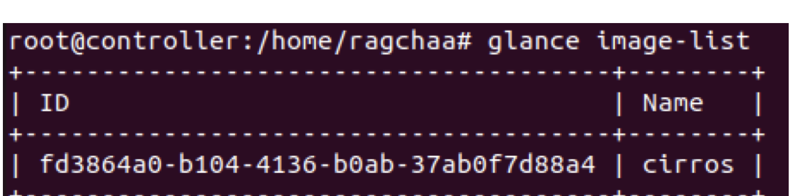
<br><sub><b>Glance</b> — CirrOS qcow2 image registered and active in the image catalog.</sub>
</td>
</tr>
<tr>
<td width="50%">
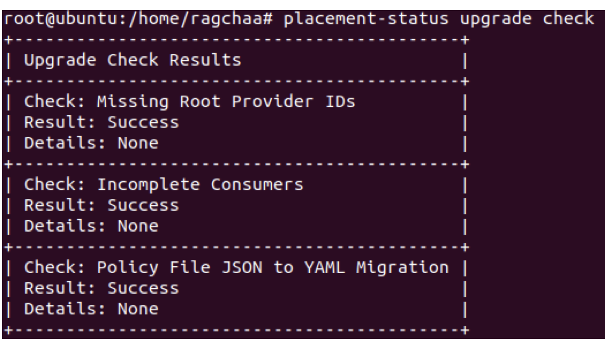
<br><sub><b>Placement</b> — <code>placement-status upgrade check</code> reporting success.</sub>
</td>
<td width="50%">
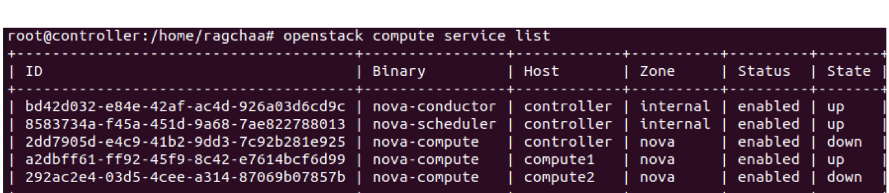
<br><sub><b>Nova</b> — conductor, scheduler, and compute hypervisor services registered.</sub>
</td>
</tr>
<tr>
<td width="50%">
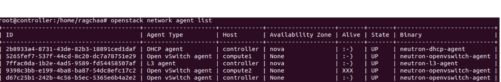
<br><sub><b>Neutron</b> — DHCP, L3, metadata, and Open vSwitch SDN agents reporting status.</sub>
</td>
<td width="50%">
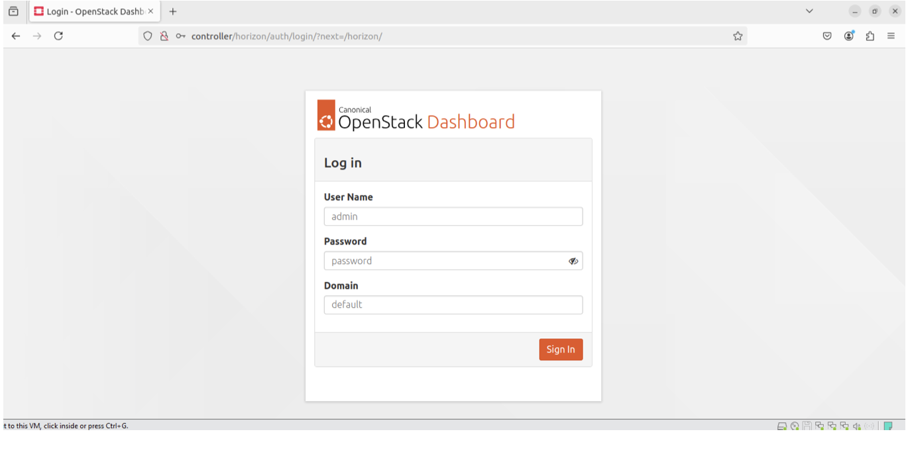
<br><sub><b>Horizon</b> — OpenStack web dashboard login interface.</sub>
</td>
</tr>
<tr>
<td width="50%">
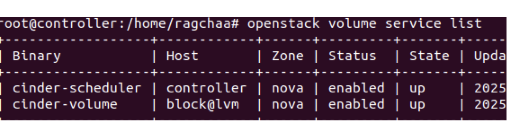
<br><sub><b>Cinder</b> — <code>cinder-scheduler</code> and LVM <code>cinder-volume</code> backend service status.</sub>
</td>
<td width="50%">
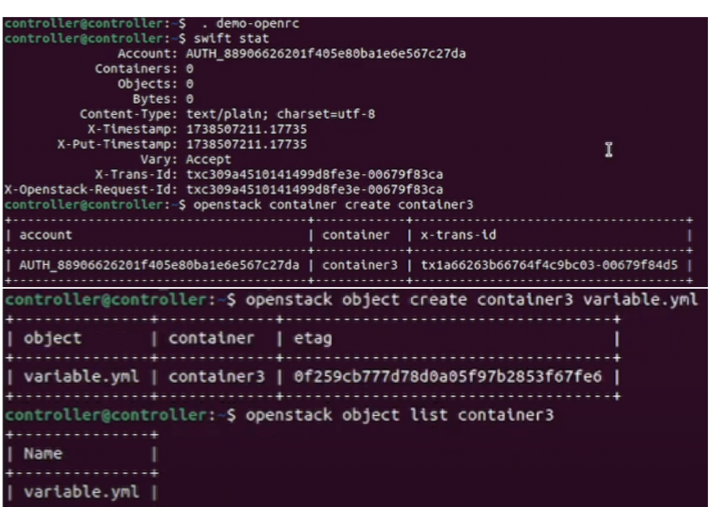
<br><sub><b>Swift</b> — <code>swift stat</code>, container creation, and object upload through Keystone auth.</sub>
</td>
</tr>
<tr>
<td width="50%">
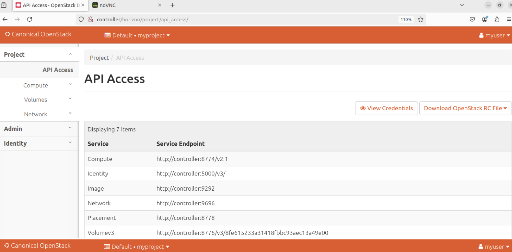
<br><sub><b>API Access</b> — Horizon service endpoint catalog across compute, identity, image, network, placement, and volume.</sub>
</td>
<td width="50%">
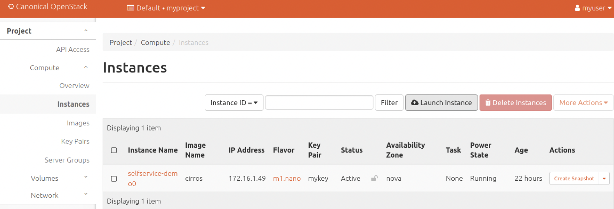
<br><sub><b>Instances</b> — Active CirrOS guest instance in Horizon Compute view.</sub>
</td>
</tr>
<tr>
<td width="50%">
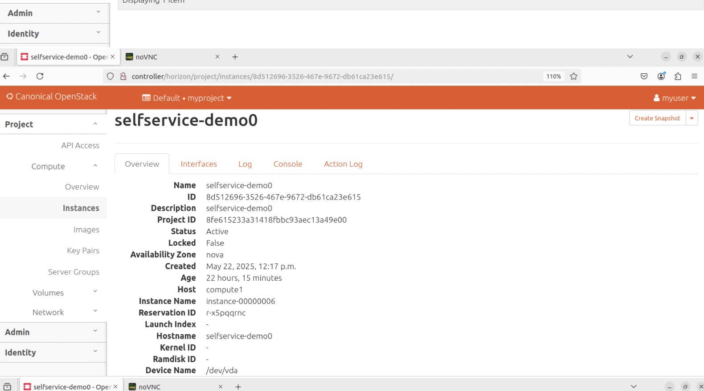
<br><sub><b>Instance Detail</b> — Hypervisor placement and network interface confirmation in Horizon.</sub>
</td>
<td width="50%">
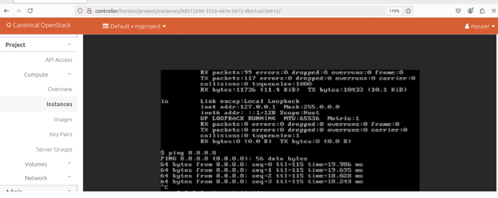
<br><sub><b>Console</b> — Outbound ICMP verification (<code>ping 8.8.8.8</code>) from the guest console through Neutron L3 SNAT.</sub>
</td>
</tr>
</table>

---

## Troubleshooting Reference

| Symptom | Likely Cause | Verification & Fix |
|---|---|---|
| Instance stuck `BUILD`, port `binding:failed` | OVS agent down or `bridge_mappings` mismatch | `openstack network agent list`, `sudo docker exec openvswitch_vswitchd ovs-vsctl show` |
| Instance `ACTIVE` but no DHCP address | `qdhcp` namespace missing or `dnsmasq` unhealthy | `ip netns list`, `sudo docker logs neutron_dhcp_agent` |
| Floating IP unreachable from host | `br-ex` physical port (`ens32`) down or missing route | `ip -br link show ens32`, `sudo ip netns exec qrouter-... iptables -t nat -S` |
| Volume attach fails or stays `attaching` | `tgtd` / `iscsid` conflict or missing `cinder-volumes` VG | `sudo vgs cinder-volumes`, `sudo docker logs cinder_volume`, `sudo docker logs iscsid` |
| Small pings work, SSH/TLS hangs | VXLAN 50-byte encapsulation exceeding 1500 underlay MTU | Verify guest `eth0` `mtu 1450`; test with `ping -M do -s 1422` vs `-s 1472` |
| Container killed with Exit Code `137` | Cgroup v2 memory ceiling (`CONSTRAINT_MEMCG`) | `sudo dmesg -T \| grep -i oom-kill`; tune `openstack_service_workers: "1"` in `globals.yml` |

Detailed STAR post-mortems: [`docs/06-troubleshooting-and-interview-star.md`](docs/06-troubleshooting-and-interview-star.md).

---

## Architecture Evolution & Roadmap

- [x] Separate management (`ens33`), VXLAN tunnel (`ens34`), and external provider (`ens32`) networks onto dedicated NICs.
- [x] Re-deploy with **Kolla-Ansible (`21.3.0`)** on **Ubuntu 24.04.5 LTS** (`OpenStack 2025.2 Flamingo`) with HAProxy + Keepalived VIP (`10.10.10.250`).
- [x] Bring both KVM compute hypervisors (`compute01` and `compute02`) into active service and verify cross-node East–West VXLAN traffic.
- [x] Verify end-to-end Floating IP SSH (`10.10.30.132`), Cinder LVM thin-pool volume attach (`/dev/vdb`), and OVS control-plane outage resilience.
- [ ] Add Prometheus + Grafana + OpenStack Exporter for full-stack observability.
- [ ] Provision tenant networks, security groups, and compute instances declaratively with Terraform (`openstack` provider).

---

## Author

**Ragchaa Battsengel** — Ulaanbaatar, Mongolia

- GitHub: [@whysari](https://github.com/whysari)
- LinkedIn: [ragchaa-battsengel](https://www.linkedin.com/in/ragchaa-battsengel-79b6183bb)
- Email: ari.whysari@gmail.com

## License

MIT — see [LICENSE](LICENSE).
