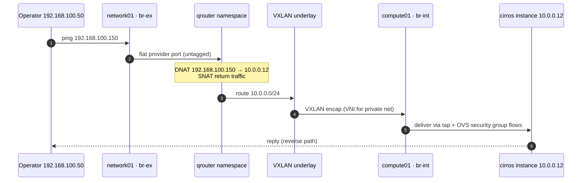

# OpenStack Caracal — 5-Node Private Cloud

A hands-on OpenStack 2024.1 (Caracal) deployment on Ubuntu 22.04 LTS: a five-node cluster with a
separated network node running Neutron ML2/Open vSwitch, VXLAN tenant overlays, flat provider
networking with floating IPs, LVM/iSCSI block storage, and a three-zone Swift object store.

The point of this repository is **reproducibility**: every non-default configuration is committed,
the topology and traffic paths are drawn out, and the verification steps are scripted so the
results can be re-run rather than taken on trust.


---

## At a glance

| | |
|---|---|
| **Release** | OpenStack 2024.1 Caracal (Ubuntu Cloud Archive) |
| **OS** | Ubuntu Server 22.04 LTS |
| **Nodes** | 5 — 1 controller, 2 computes, 1 network, 1 storage |
| **Control plane** | Keystone, Glance, Placement, Nova, Neutron, Cinder, Swift, Horizon |
| **SDN** | Neutron ML2 + Open vSwitch, VXLAN overlays (`1:1000`), L2 population |
| **East–west** | VXLAN tunnels over the management network (`br-tun`) |
| **North–south** | Flat provider network `192.168.100.0/24`, virtual routers, SNAT + floating IPs |
| **Block storage** | Cinder LVM over iSCSI (`tgt`), VG `cinder-volumes` |
| **Object storage** | Swift, 3 zones / 3 replicas / 1024 partitions, Keystone auth |
| **Verified** | Instance boot, DHCP, metadata, floating IP, SSH, volume attach, object round-trip |

---

## Architecture

### Logical topology


The SVG is the version used throughout this README. A Mermaid equivalent of the same topology is
kept in [`diagrams/architecture.mmd`](diagrams/architecture.mmd) for editing as code.

### Network planes

| Plane | Subnet | Purpose |
|---|---|---|
| Management / API | `10.10.10.0/24` | Keystone, SQL, AMQP, API endpoints, VXLAN underlay |
| Provider / external | `192.168.100.0/24` | Flat external network, router gateway, floating IPs |
| Tenant overlay | VXLAN VNI `1–1000` | Self-service networks, isolated per project |

> **Lab simplification:** VXLAN uses the management interface as its underlay
> (`local_ip = 10.10.10.x`) instead of a dedicated tunnel network. In production the tunnel
> network would be separated from the API network and `path_mtu` tuned to the underlay.

### Node roles

| Host | Mgmt IP | vCPU / RAM / Disk | Services |
|---|---|---|---|
| `controller01` | `10.10.10.11` | 4 / 8 GB / 80 GB | Keystone, Glance, Placement, Nova API+scheduler+conductor, Neutron server, Cinder API+scheduler, Horizon, Swift proxy, MariaDB, RabbitMQ, Memcached |
| `compute01` | `10.10.10.21` | 4 / 16 GB / 100 GB | `nova-compute`, `libvirt`/KVM, Neutron OVS agent, Swift zone 2 |
| `compute02` | `10.10.10.22` | 4 / 16 GB / 100 GB | `nova-compute`, `libvirt`/KVM, Neutron OVS agent, Swift zone 3 |
| `network01` | `10.10.10.31` | 2 / 4 GB / 40 GB | Neutron L3, DHCP, metadata, OVS agent, `br-ex` |
| `storage01` | `10.10.10.41` | 4 / 8 GB / 200 GB | `cinder-volume` (LVM + `tgt`), Swift zone 1 |

Swift is deliberately spread across three nodes so the ring has three failure zones and
replication is real, not simulated. Cinder lives only on `storage01`; a second volume node is
listed in the roadmap.

### How a floating-IP packet moves



The router namespace on `network01` owns the floating IP and performs DNAT/SNAT. The compute node
never sees the provider network, which is why `br-ex` exists only on `network01`.

---

## Repository layout

```
.
├── README.md
├── configs/                  # Committed, sanitised config files (passwords are placeholders)
│   ├── controller/           # keystone, glance, placement, nova, neutron, cinder, horizon
│   ├── compute/              # nova.conf, openvswitch_agent.ini
│   ├── network/              # l3, dhcp, metadata, OVS agent, neutron.conf
│   ├── storage/              # cinder.conf, swift/*.conf
│   ├── netplan/              # Per-host netplan YAML, including the OVS provider bridge
│   └── ovs/                  # br-ex bootstrap / recovery script
├── diagrams/                 # Architecture SVG/PNG + Mermaid sources
├── docs/                     # Step-by-step build notes + verification + troubleshooting
├── scripts/                  # Preflight, network bootstrap, smoke test, evidence capture
└── evidence/                 # Captured verification output (see evidence/README.md)
```

---

## Build order

Each phase ends with a verification gate. Don't continue until the gate passes — most OpenStack
failures are a broken earlier layer surfacing late.

| # | Phase | Doc | Gate |
|---|---|---|---|
| 00 | Host prep, netplan, OVS, NTP | [docs/01-host-preparation.md](docs/01-host-preparation.md) | All 5 hosts resolve and reach each other |
| 01 | Keystone, MariaDB, RabbitMQ, Memcached | [docs/02-keystone.md](docs/02-keystone.md) | `openstack token issue` |
| 02 | Glance + Placement | [docs/03-glance-placement.md](docs/03-glance-placement.md) | Image `active`, Placement API responds |
| 03 | Nova control plane + computes | [docs/04-nova.md](docs/04-nova.md) | `openstack compute service list` — 4 services up |
| 04 | Neutron ML2/OVS + agents | [docs/05-neutron.md](docs/05-neutron.md) | `openstack network agent list` — all agents up |
| 05 | Cinder LVM/iSCSI | [docs/06-cinder.md](docs/06-cinder.md) | Volume reaches `available`, attaches |
| 06 | Swift rings + proxy | [docs/07-swift.md](docs/07-swift.md) | Object PUT/GET round-trip |
| 07 | Horizon | [docs/08-horizon.md](docs/08-horizon.md) | Login and launch from UI |
| 08 | End-to-end smoke test | [docs/09-verification.md](docs/09-verification.md) | Everything below passes |

### Base packages (all nodes)

```bash
sudo apt update && sudo apt upgrade -y
sudo apt install -y software-properties-common chrony
sudo add-apt-repository -y cloud-archive:caracal
sudo apt update && sudo apt install -y python3-openstackclient
```

Pin the release so a later `apt upgrade` doesn't drag the cluster onto a newer OpenStack:

```bash
sudo apt-mark hold 'python3-*openstack*' 'nova-*' 'neutron-*' 'cinder-*' 'swift-*' 'keystone' 'glance' 'placement-*'
```

---

## Key configuration

Full files live in [`configs/`](configs/). The three that define this deployment's behaviour:

### ML2 — drivers and overlay range

```ini
# /etc/neutron/plugins/ml2/ml2_conf.ini (controller01)
[ml2]
type_drivers = flat,vlan,vxlan
tenant_network_types = vxlan
mechanism_drivers = openvswitch,l2population
extension_drivers = port_security
path_mtu = 1500

[ml2_type_flat]
flat_networks = provider

[ml2_type_vxlan]
vni_ranges = 1:1000
```

### OVS agent — bridge mapping and tunnel endpoint

```ini
# /etc/neutron/plugins/ml2/openvswitch_agent.ini (network01)
[ovs]
bridge_mappings = provider:br-ex
local_ip = 10.10.10.31

[agent]
tunnel_types = vxlan
l2_population = true

[securitygroup]
firewall_driver = openvswitch
```

Compute nodes use the same file **without** `bridge_mappings` — they only need `br-int` and
`br-tun`, because floating IPs terminate on the network node.

### Cinder — LVM backed by iSCSI

```ini
# /etc/cinder/cinder.conf (storage01)
[DEFAULT]
enabled_backends = lvm-iscsi
my_ip = 10.10.10.41

[lvm-iscsi]
volume_driver = cinder.volume.drivers.lvm.LVMVolumeDriver
volume_group = cinder-volumes
target_protocol = iscsi
target_helper = tgtadm
target_ip_address = 10.10.10.41
volume_backend_name = lvm-iscsi
```

Create the backend before starting the service:

```bash
sudo pvcreate /dev/sdb
sudo vgcreate cinder-volumes /dev/sdb
sudo systemctl enable --now tgt
```

> The examples above are sanitised. Real passwords are never committed — see
> [`configs/README.md`](configs/README.md) for the placeholder list.

---

## Verification

All commands below assume `source ~/admin-openrc` and run from `controller01`.

### 1. Control plane

```bash
openstack compute service list
openstack network agent list
openstack volume service list
```

Expected: `nova-conductor`, `nova-scheduler`, `nova-compute` ×2 enabled and up; OVS agents on
`network01` and both computes, plus L3/DHCP/metadata on `network01` (six agents total);
`cinder-scheduler` and `cinder-volume` up.

### 2. OVS data path

```bash
# network01
sudo ovs-vsctl show
sudo ovs-vsctl list-br
# → br-ex, br-int, br-tun

# compute01
sudo ovs-vsctl show
# → br-int, br-tun, patch ports to br-tun, VXLAN port with remote_ip 10.10.10.31
```

`br-ex` should have exactly one external port (`enp2s0`) and **no IP address** — the IP lives in
the router namespace.

### 3. Namespaces and routing

```bash
# network01
sudo ip netns
# qrouter-<router-uuid>
# qdhcp-<private-net-uuid>

sudo ip netns exec qrouter-<uuid> ip -4 addr show
sudo ip netns exec qrouter-<uuid> ip route
sudo ip netns exec qrouter-<uuid> iptables -t nat -S | grep -E 'SNAT|DNAT'
```

Expected: the router holds the gateway IP on the private subnet and the floating IP on the
provider subnet; NAT rules map `10.0.0.0/24` to the router's external address and DNAT each
floating IP to its fixed IP.

### 4. Instance, floating IP, SSH

```bash
openstack server list
openstack floating ip list
ping -c 3 192.168.100.150
ssh cirros@192.168.100.150      # cirros default password: gocubsgo
```

### 5. Volume attach

```bash
openstack volume create --size 1 demo-vol
openstack server add volume cirros-01 demo-vol
openstack volume show demo-vol -c status -c attachments
# status: in-use, attached to cirros-01

ssh cirros@192.168.100.150 'lsblk'
# → vdb 1G present
```

### 6. Swift round-trip

```bash
openstack object create demo-container README.md
openstack object list demo-container
openstack object save demo-container README.md --file /tmp/README.roundtrip.md
md5sum README.md /tmp/README.roundtrip.md   # hashes must match
swift-ring-builder /etc/swift/object.builder # 1024 partitions, 3 replicas, 3 zones
```

---

## Smoke test results

Captured with [`scripts/20-smoke-test.sh`](scripts/20-smoke-test.sh) and
[`scripts/30-collect-evidence.sh`](scripts/30-collect-evidence.sh); raw output is captured under
[`evidence/`](evidence/).

| # | Check | Pass criterion | Result |
|---|---|---|---|
| 1 | Keystone token | `openstack token issue` returns a token | ✅ |
| 2 | Nova services | 4 services enabled, state `up` | ✅ |
| 3 | Neutron agents | 6 agents alive, state `UP` | ✅ |
| 4 | Cinder services | scheduler + volume `up` | ✅ |
| 5 | Instance boot | `cirros-01` reaches `ACTIVE` on private net | ✅ |
| 6 | DHCP + metadata | Instance gets `10.0.0.x`, `169.254.169.254` responds | ✅ |
| 7 | East–west | ping between instances on different computes | ✅ |
| 8 | Floating IP | ping + SSH from `192.168.100.0/24` | ✅ |
| 9 | Volume attach | 1 GiB volume `in-use`, `/dev/vdb` visible in guest | ✅ |
| 10 | Swift round-trip | PUT/GET byte-identical; ring shows 3 zones / 3 replicas | ✅ |

> Re-run the scripts and commit a fresh `evidence/` directory before publishing, so every row is
> reproducible from this repository.

---

## Troubleshooting notes

| Symptom | Likely cause | Fix |
|---|---|---|
| Instance stuck `BUILD`, port `binding:failed` | OVS agent down or `bridge_mappings` mismatch | `openstack network agent list`, `journalctl -u neutron-openvswitch-agent` |
| Instance `ACTIVE` but no DHCP | `qdhcp` namespace missing / dnsmasq dead | `ip netns`, `journalctl -u neutron-dhcp-agent`, check `[dhcp] interface_driver` |
| Metadata 500 / no `169.254.169.254` | Shared secret mismatch between Nova and metadata agent | Compare `metadata_proxy_shared_secret` in `nova.conf` and `metadata_agent.ini` |
| Floating IP unreachable | `br-ex` mapping, missing gateway, or `rp_filter` | `ovs-vsctl show`, `ip netns exec qrouter-… ip route`, `sysctl net.ipv4.ip_forward` |
| Volume attach fails | `tgt` down, wrong `target_ip_address`, IQN ACL | `systemctl status tgt`, `tgtadm --mode target --op show`, `cinder-volume` logs |
| Swift 503 | Ring not rebalanced or `/srv/node/d1` not mounted | `swift-ring-builder …`, `swift-init all status`, `mount` |
| `AMQPChannelAddressError` | RabbitMQ down or wrong `transport_url` | `rabbitmqctl cluster_status`, `rabbitmqctl list_users` |
| SSH to instance times out but ping works | Security group lacks TCP/22 | `openstack security group rule create --proto tcp --dst-port 22 default` |
| MTU-related hangs on large packets | VXLAN overhead with 1500-byte underlay | Set `path_mtu = 1500`, verify guest MTU 1450 via DHCP |

More detail: [`docs/10-troubleshooting.md`](docs/10-troubleshooting.md).

---

## Design decisions and trade-offs

1. **ML2/OVS instead of OVN.** Deliberate: the goal was to operate the classic OVS/VXLAN data
   path — bridges, patch ports, tunnel endpoints, namespaces — rather than let OVN hide it.
   Trade-off: more agents and namespaces to run, and no OVN-style distributed routing.
2. **Separate network node.** Keeps L3/DHCP/metadata and `br-ex` off the computes and makes the
   north–south path easy to observe. Trade-off: a single north–south choke point.
3. **Single controller.** No HA; Galera, RabbitMQ quorum queues, and HAProxy/Keepalived are the
   documented next step, not something this repo pretends to have.
4. **LVM/iSCSI for Cinder.** Real block semantics with no extra hardware. Trade-off: no
   replication; snapshots are LVM-backed and local to one node.
5. **Swift across three zones.** One loopback-backed device per node gives genuine 3-replica
   placement and rsync replication while still fitting five hosts.

### Known limitations

- Single controller and single network node — no control-plane or L3 HA.
- Swift devices are loopback files (`/srv/node/d1`), not dedicated disks.
- No TLS on the internal API network; lab credentials only.
- No Ceph, Octavia, Telemetry, or centralised logging yet.
- Provider network is flat and untagged; VLAN provider networks are not exercised.

---

## Roadmap

- [ ] Three-controller HA: Galera, RabbitMQ quorum queues, HAProxy + Keepalived, etcd for Cinder
      active-active coordination.
- [ ] Replace loopback Swift devices with dedicated disks; test disk failure and rebalance.
- [ ] Ceph RBD backend for Cinder and Glance.
- [ ] Prometheus + Grafana + Loki for cluster observability.
- [ ] Re-deploy with Kolla-Ansible and compare against this hand-built baseline.
- [ ] Terraform the instance/network layer on top of the cloud.

---

## References

- [OpenStack Caracal install guide (Ubuntu)](https://docs.openstack.org/2024.1/install/)
- [Neutron OVS self-service networks](https://docs.openstack.org/neutron/2024.1/admin/deploy-ovs-selfservice.html)
- [Swift deployment and rings](https://docs.openstack.org/swift/2024.1/install/)
- [Cinder LVM driver](https://docs.openstack.org/cinder/2024.1/configuration/block-storage/drivers/lvm-volume-driver.html)

---

## Author

**Ragchaa Battsengel** — Ulaanbaatar, Mongolia

- GitHub: [@arionssky](https://github.com/arionssky)
- LinkedIn: [ragchaa-battsengel](https://www.linkedin.com/in/ragchaa-battsengel-79b6183bb)
- Email: ari.whysari@gmail.com

## License

MIT — see [LICENSE](LICENSE).
