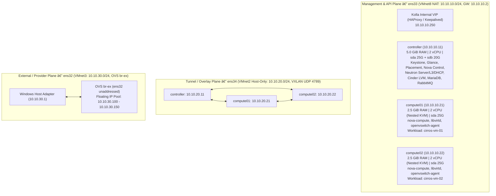

# OpenStack 2024.1 (Caracal) Multi-Node Private Cloud — Ground-Up Build

> **Note:** This repository documents a **100% from-scratch, ground-up build** of a 3-node OpenStack 2024.1 (Caracal) private cloud deployed with **Kolla-Ansible** on **Ubuntu 24.04.5 LTS (Noble Numbat)** (`6.8.0-147-generic`), paired with low-level **Linux Kernel (Cgroups v2, OOM Killer), LVM/iSCSI Storage, and Software-Defined Networking (Linux Namespaces, Open vSwitch, VXLAN)** verification labs. Every stage is backed by raw terminal outputs captured directly from the live cluster in [`evidence/`](evidence/).

---

## 1. Physical Host & Virtualization Lab Specifications

- **Hypervisor Host:** Windows 11 + VMware Workstation Pro 17
- **CPU:** Intel Core i5-9400F (6 Physical Cores @ 2.90 GHz, Hardware VT-x + EPT Nested Virtualization enabled, `/dev/kvm` verified across all nodes)
- **Host Memory:** 16 GB DDR4 (10.0 GiB allocated across the 3 cluster nodes + `zram` lz4 swap compression)
- **Base OS:** Ubuntu Server 24.04.5 LTS (`Linux 6.8.0-147-generic`)
- **Deployment Method:** Kolla-Ansible (Dockerized OpenStack Control & Data Plane with HAProxy/Keepalived VIP)

---

## 2. 3-Node Cluster Topology & Network Planes

### Node Inventory

| Hostname | Role(s) | RAM / Swap | vCPU | Mgmt IP (`ens33`) | Tunnel IP (`ens34`) | External NIC (`ens32`) | Storage Disks |
| :--- | :--- | :--- | :--- | :--- | :--- | :--- | :--- |
| **`controller`** | Control, Network, Storage (Cinder LVM) | 5.0 GiB + zram | 2 (VT-x) | `10.10.10.11/24` | `10.10.20.11/24` | Unaddressed (`br-ex`) | `sda` (23G Root LV) + `sdb` (20G `cinder-volumes` VG) |
| **`compute01`** | Hypervisor #1 (KVM) + OVS Agent | 2.5 GiB + zram | 2 (VT-x) | `10.10.10.21/24` | `10.10.20.21/24` | Unaddressed (`br-ex`) | `sda` (23G Root LV + Nova instances) |
| **`compute02`** | Hypervisor #2 (KVM) + OVS Agent | 2.5 GiB + zram | 2 (VT-x) | `10.10.10.22/24` | `10.10.20.22/24` | Unaddressed (`br-ex`) | `sda` (23G Root LV + Nova instances) |

---

## 3. Engineering Runbooks & Live Evidence

| Module | Engineering Runbook | Verified Evidence Log | Status |
| :--- | :--- | :--- | :--- |
| **01. Host & 3-Plane Networking** | [`docs/01-host-and-network-setup.md`](docs/01-host-and-network-setup.md) | [`evidence/00-env-discovery.txt`](evidence/00-env-discovery.txt) | ✅ Verified |
| **02. Linux Cgroups v2 & Cinder LVM** | [`docs/02-linux-cgroups-and-lvm.md`](docs/02-linux-cgroups-and-lvm.md) | [`evidence/01-week1-linux-lvm-cgroups.txt`](evidence/01-week1-linux-lvm-cgroups.txt) | ✅ Verified |
| **03. Linux SDN, Namespaces & VXLAN** | `docs/03-sdn-namespaces-vxlan.md` *(in progress)* | `evidence/02-week2-sdn-vxlan-mtu.txt` | ⏳ In Progress |
| **04. Kolla-Ansible Multinode Deploy** | `docs/04-kolla-ansible-deployment.md` | `evidence/03-kolla-control-plane.txt` | ⬜ Planned |
| **05. Workloads & Outage Drills** | `docs/05-workloads-and-failure-drills.md` | `evidence/04-workloads-and-drills.txt` | ⬜ Planned |

---

## 4. Execution Roadmap & Live Verification Status

- [x] **Step 01 — Hardware & VM Discovery:** Verified 3 Ubuntu 24.04.5 LTS nodes, `/dev/kvm` nested hardware virtualization, 3 NICs (`ens33`, `ens34`, `ens32`), and 20 GB raw block disk (`sdb`) on `controller` → [`evidence/00-env-discovery.txt`](evidence/00-env-discovery.txt)
- [x] **Step 02 — Base Networking, Root LVM Expansion & Week 1 Linux Internals:** → [`evidence/01-week1-linux-lvm-cgroups.txt`](evidence/01-week1-linux-lvm-cgroups.txt)
  - Locked static Netplan IPs (`10.10.10.11/21/22` & `10.10.20.11/21/22`), unique hostnames, and passwordless SSH mesh (~0.25 ms inter-node RTT)
  - Expanded root LV (`ubuntu-lv`) from 11.5 GiB to full 23.0 GiB across all 3 nodes
  - Provisioned `cinder-volumes` LVM Volume Group (`20.00 GiB` free) on `controller:/dev/sdb`
  - Executed deterministic Cgroups v2 (`MemoryMax=32M`) OOM-killer drill and captured `CONSTRAINT_MEMCG` trace (`anon-rss:32512kB`)
- [x] **Step 03 — Week 2 Software-Defined Networking (SDN) Drill:**
  - Isolated Linux network namespaces (`ip netns`), `veth` pairs, cross-node VXLAN overlay encapsulation (`UDP 4789`, VNI `100`), MTU overhead (`1450` vs `1500` PMTUD), and NAT/Floating IP packet path verification
- [ ] **Step 04 — Week 3 Kolla-Ansible Multinode Deployment:**
  - Bootstrap servers, deploy MariaDB, RabbitMQ, Keystone, Glance, Placement, Nova (KVM), Neutron (ML2/OVS), Cinder (LVM/iSCSI), and Horizon via `kolla-ansible -i multinode deploy`
- [ ] **Step 05 — Workload Verification & Failure Drills (Week 4):**
  - Launch `cirros-vm-01` on `compute01` and `cirros-vm-02` on `compute02`
  - Verify cross-node VXLAN East-West traffic, Cinder volume attach, Floating IP North-South reachability, and outage drills

