# 05 -- Day-2 Cloud Operations: Multi-Node Workloads, VXLAN/Floating-IP Packet Paths, Cinder iSCSI Attach & Outage Drill

## 1. Architectural Overview

With the 3-node **OpenStack 2025.2 (Flamingo)** control and data planes active, we executed full end-to-end tenant provisioning and fault-injection drills to verify distributed cloud behavior across `controller`, `compute01`, and `compute02`:

1. **Multi-Node Scheduling:** Pinned `cirros-vm-01` to `compute01` (`10.10.10.21`) and `cirros-vm-02` to `compute02` (`10.10.10.22`) to force East-West tenant traffic across the physical VXLAN overlay (`ens34`: `10.10.20.0/24`).
2. **North-South Floating IP DNAT/SNAT:** Routed external traffic (`10.10.30.132` on `public-net` / `br-ex`) through `demo-router` (`qrouter-fd19fb5e-4fb4-46c0-964c-417e737a2f19` namespace on `controller`) to `cirros-vm-01` (`192.168.100.237`).
3. **Remote Cinder Block Storage (`LVM + iSCSI`):** Carved a 1 GiB thin-provisioned Logical Volume (`volume-acf33885-2cb2-4538-a420-2e542cc7f748`) from `cinder-volumes` on `controller:/dev/sdb` and attached it over the network via iSCSI (`tgtd` -> `iscsid`) to `cirros-vm-01` on `compute01` as `/dev/vdb`.
4. **Control-Plane vs. Data-Plane Decoupling Drill:** Stopped `neutron_openvswitch_agent` on `compute01` while actively pinging `cirros-vm-01`, proving that Open vSwitch (`openvswitch_vswitchd` + Linux kernel datapath flows) continues forwarding traffic with 0% packet loss even when the Python control agent is down.

---

## 2. End-to-End Packet Path Architecture

```mermaid
flowchart LR
    subgraph EXT["External Plane (10.10.30.0/24)"]
        EXT_CLIENT["External Client / Host"]
    end

    subgraph CTRL["controller (10.10.10.11 / 10.10.20.11)"]
        BREX["OVS br-ex (ens32)"]
        QROUTER["ip netns: qrouter-fd19fb5e...<br/>GW: 10.10.30.142 (qg-ffd42f43-ab)<br/>DNAT -> 192.168.100.237 (qr-e86a4b9f-d5)"]
        CTRL_TUN["OVS br-tun<br/>vxlan-0a0a1415 -> 10.10.20.21"]
    end

    subgraph COMP1["compute01 (10.10.10.21 / 10.10.20.21)"]
        C1_TUN["OVS br-tun (ens34)"]
        C1_INT["OVS br-int (tag: 1)<br/>Port: qvo2eb7fb00-41"]
        VM1["cirros-vm-01<br/>Fixed IP: 192.168.100.237 (MTU 1450)<br/>Floating IP: 10.10.30.132<br/>Cinder Disk: /dev/vdb (1 GiB)"]
    end

    subgraph COMP2["compute02 (10.10.10.22 / 10.10.20.22)"]
        C2_TUN["OVS br-tun (ens34)"]
        C2_INT["OVS br-int (tag: 1)<br/>Port: qvo197a918b-53"]
        VM2["cirros-vm-02<br/>Fixed IP: 192.168.100.218 (MTU 1450)"]
    end

    EXT_CLIENT -->|10.10.30.132| BREX --> QROUTER --> CTRL_TUN
    CTRL_TUN -->|VXLAN UDP 4789| C1_TUN --> C1_INT --> VM1
    VM1 <-->|East-West VXLAN UDP 4789<br/>10.10.20.21 <-> 10.10.20.22| C2_TUN <--> C2_INT <--> VM2
```



---

## 3. Executed Provisioning & Verification Commands

### 3.1 Glance Image, Nova Flavor & Neutron Topology
```bash
source ~/kolla-venv/bin/activate
source /etc/kolla/admin-openrc.sh

# Upload CirrOS 0.6.2 image & create m1.tiny flavor
openstack image create "cirros-0.6.2" \
  --file ~/cirros-0.6.2-x86_64-disk.img \
  --disk-format qcow2 --container-format bare --public
openstack flavor create --id 1 --ram 256 --disk 1 --vcpus 1 m1.tiny

# External flat provider network (physnet1 -> br-ex -> ens32)
openstack network create --external \
  --provider-physical-network physnet1 \
  --provider-network-type flat public-net
openstack subnet create --network public-net \
  --allocation-pool start=10.10.30.100,end=10.10.30.150 \
  --dns-nameserver 8.8.8.8 --gateway 10.10.30.1 \
  --subnet-range 10.10.30.0/24 public-subnet

# Tenant VXLAN overlay network (192.168.100.0/24) & Router
openstack network create private-net
openstack subnet create --network private-net \
  --dns-nameserver 8.8.8.8 --gateway 192.168.100.1 \
  --subnet-range 192.168.100.0/24 private-subnet

openstack router create demo-router
openstack router set --external-gateway public-net demo-router
openstack router add subnet demo-router private-subnet
```

### 3.2 Multi-Node Instance Placement (`compute01` & `compute02`), Floating IP & Cinder Attach
```bash
# Security group & SSH keypair
openstack security group create allow-ping-ssh --description "Allow ICMP and SSH"
openstack security group rule create --proto icmp allow-ping-ssh
openstack security group rule create --proto tcp --dst-port 22 allow-ping-ssh
openstack keypair create --public-key ~/.ssh/id_ed25519.pub demo-key

# Boot cirros-vm-01 on compute01 and cirros-vm-02 on compute02
openstack server create --flavor m1.tiny --image cirros-0.6.2 --network private-net \
  --security-group allow-ping-ssh --key-name demo-key --availability-zone nova:compute01 --wait cirros-vm-01

openstack server create --flavor m1.tiny --image cirros-0.6.2 --network private-net \
  --security-group allow-ping-ssh --key-name demo-key --availability-zone nova:compute02 --wait cirros-vm-02

# Assign Floating IP (10.10.30.132) & attach 1 GiB Cinder LVM volume (/dev/vdb)
FIP=$(openstack floating ip create public-net -f value -c floating_ip_address)
openstack server add floating ip cirros-vm-01 $FIP

openstack volume create --size 1 demo-vol-01
openstack server add volume cirros-vm-01 demo-vol-01
```

---

## 4. Verified Live Results

### 4.1 Multi-Node Instance Placement (`openstack server list --long`)
```text
+--------------------------------------+--------------+--------+------------+-------------+-------------------------------------------+--------------+---------+-----------+-------------+
| ID                                   | Name         | Status | Task State | Power State | Networks                                  | Image Name   | Flavor  | Host      | Host Status |
+--------------------------------------+--------------+--------+------------+-------------+-------------------------------------------+--------------+---------+-----------+-------------+
| dd5278d2-d9a7-4993-b231-5ded1a26b829 | cirros-vm-02 | ACTIVE | None       | Running     | private-net=192.168.100.218               | cirros-0.6.2 | m1.tiny | compute02 | UP          |
| 5f64ee18-3910-4d07-bece-3ee941b6889f | cirros-vm-01 | ACTIVE | None       | Running     | private-net=10.10.30.132, 192.168.100.237 | cirros-0.6.2 | m1.tiny | compute01 | UP          |
+--------------------------------------+--------------+--------+------------+-------------+-------------------------------------------+--------------+---------+-----------+-------------+
```

### 4.2 Guest SSH, `MTU 1450`, Attached `/dev/vdb` & Cross-Node East-West VXLAN Ping
```text
=== SSH INTO CIRROS-VM-01 & EAST-WEST VXLAN PING TO CIRROS-VM-02 (192.168.100.218) ===
cirros-vm-01
2: eth0: <BROADCAST,MULTICAST,UP,LOWER_UP> mtu 1450 qdisc pfifo_fast qlen 1000
    inet 192.168.100.237/24 brd 192.168.100.255 scope global dynamic noprefixroute eth0
 252        0    1048576 vda
 252       16    1048576 vdb
PING 192.168.100.218 (192.168.100.218) 56(84) bytes of data.
64 bytes from 192.168.100.218: icmp_seq=1 ttl=64 time=4.71 ms
64 bytes from 192.168.100.218: icmp_seq=2 ttl=64 time=1.06 ms
64 bytes from 192.168.100.218: icmp_seq=3 ttl=64 time=2.59 ms
--- 192.168.100.218 ping statistics ---
3 packets transmitted, 3 received, 0% packet loss, time 2004ms
rtt min/avg/max/mdev = 1.055/2.785/4.711/1.498 ms
```

### 4.3 Host LVM Thin Pool vs. Guest Block Device Verification
```text
=== CONTROLLER LVM HOST STORAGE (cinder-volumes VG & LV) ===
  LV                                          VG             Attr       LSize   Pool
  cinder-volumes-pool                         cinder-volumes twi-aotz--  19.00g
  volume-acf33885-2cb2-4538-a420-2e542cc7f748 cinder-volumes Vwi-aotz--   1.00g cinder-volumes-pool

=== GUEST OS DISK VIEW (lsblk inside cirros-vm-01) ===
NAME    MAJ:MIN RM  SIZE RO TYPE MOUNTPOINTS
vda     252:0    0    1G  0 disk
|-vda1  252:1    0 1015M  0 part /
`-vda15 252:15   0    8M  0 part
vdb     252:16   0    1G  0 disk
```

- **Full Raw Evidence Log (378 lines):** [`evidence/04-workloads-and-drills.txt`](../evidence/04-workloads-and-drills.txt)
